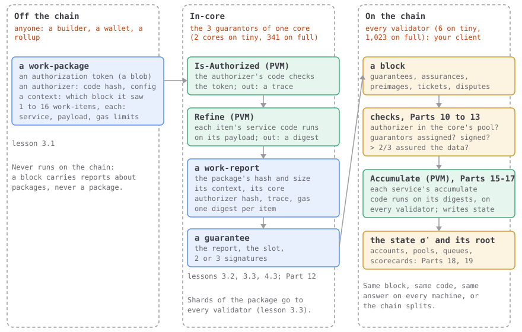

# Part 3 · Work and reports

**In one sentence:** work goes into JAM as a parcel for one core and comes back as a receipt
for every validator, and this part teaches your client to read both.

What sets JAM apart from other blockchains is where the work happens: **in-core**, on one
core's guarantors, while every other validator checks a report of it. This part encodes
the paperwork of that journey, each piece checked against the official vectors.

By the end of this part your client encodes and decodes a work-package, its digests and
the work-report that binds them.

## The big picture

Work reaches JAM in a parcel and comes back as a receipt, and the two are written for
different readers. The parcel, a *work-package*, is for the three guarantors of one core:
it carries everything they need to run the work. The receipt, a *work-report*, is for
every validator: it carries only what the chain needs to check the work and act on it,
and the chain never sees the parcel at all.

Who does what, and where:

1. **Off the chain**, a builder makes a work-package: 1 to 16 *work-items*, each a service,
   a payload and gas limits; a *context* saying which recent block the package saw; and a
   permission slip, an *authorizer* (a PVM program plus settings, named by one hash;
   [Part 13](../13-authorization/index.md)) with a token for it.
2. **In-core**, the core's three guarantors run the authorizer on the package, then each
   item's service code on its payload, in the PVM ([Part 15](../15-the-pvm/index.md)).
   Each item's answer is a *work digest*, a small card saying how it went. They bundle the
   digests with the package's hash and size, its context, the core and the authorizer's
   hash and output into a report, and sign it ([4.3](../04-blocks/03-guarantees.md), [Part
   12](../12-guarantees/index.md)). They also cut the package into shards and send one to
   every validator ([Part 11](../11-assurances/index.md)).
3. **On the chain**, every validator, your client included, reads the report out of the
   block, checks who signed it and which authorizer let it in (Parts
   [12](../12-guarantees/index.md) and [13](../13-authorization/index.md)), waits until
   enough shards are assured ([Part 11](../11-assurances/index.md)), and finally hands each
   digest to its service's accumulate code ([Part 17](../17-accumulation/index.md)).

The paper calls the off-chain half of this *honest behavior*, and opens §14 with it:

::: gray-paper 14.1

#### §14.1 Honest Behavior {#gp-14-1}

We have so far specified how to recognize blocks for a correctly transitioning JAM blockchain. Through defining the state transition function and a state <abbr class="gp-term" title="hashing many values down to one root through a tree, so one 32-byte hash stands for them all">Merklization</abbr> function, we have also defined how to recognize a valid header. While it is not especially difficult to understand how a new block may be authored for any node which controls a key which would allow the creation of the two signatures in the header, nor indeed to fill in the other header fields, readers will note that the contents of the extrinsic remain unclear.

We define not only correct behavior through the creation of correct blocks but also *honest behavior*, which involves the node taking part in several *off-chain* activities. This does have analogous aspects within *YP* Ethereum, though it is not mentioned so explicitly in said document: the creation of blocks along with the gossiping and inclusion of transactions within those blocks would all count as off-chain activities for which honest behavior is helpful. In JAM's case, honest behavior is well-defined and expected of at least ${}^{2}\!/_{3}$ of validators.

Beyond the production of blocks, incentivized honest behavior includes:

- the guaranteeing and reporting of work-packages, along with chunking and distribution of both the chunks and the work-package itself, discussed in section [15](../what-runs-where.md#gp-15-p1);
- assuring the availability of work-packages after being in receipt of their data;
- determining which work-reports to audit, fetching and auditing them, and creating and distributing judgments appropriately based on the outcome of the audit;
- submitting the correct amount of auditing work seen being done by other validators, discussed in section [13](../18-statistics/index.md#gp-13-1-p1).

:::

Your client never builds a package and never refines one: block import only decodes and
checks. But a report makes no sense without knowing what it reports on, so this part
encodes all three, and checks each against the vectors.

| Thing | Made from | Made by, where | Lesson |
| --- | --- | --- | --- |
| work-item | a service id, a payload, gas limits for refine and accumulate, what it imports, exports and brings along | the builder, off the chain | [3.1](./01-a-work-package.md) |
| work-package | an authorization token, an authorizer (the service holding its code, the code hash, a configuration), a context, 1 to 16 items | the builder, off the chain | [3.1](./01-a-work-package.md) |
| work digest | the item's service, code hash and payload hash, its accumulate gas, its result (output bytes, or an error) and what refining it cost | the guarantors, in-core | [3.2](./02-work-digests.md) |
| work-report | the package's spec (hash, size, erasure root, exports root), its context, its core, the authorizer's hash, trace and gas, a segment-root lookup, one digest per item | the guarantors, in-core | [3.3](./03-a-work-report.md) |

If you build web services: the package is a request body with its authorization header,
and the report is a signed receipt for having handled it. Nobody answers the sender
directly; the result lands in the chain's state when the service accumulates it. [What
runs where](../what-runs-where.md) keeps this map beside every part.

**Builds on** the foundations alone, [Parts 0 to 2](../index.md#lessons).

## At a glance

The whole part on one map. Boxes are what your client holds, and rounded cards are the
steps between them; a dashed card happens outside your client. The bands say where each
step runs: off the chain, in-core, or on-chain, where your client comes in. Tap any card,
or walk through them in order with *next*.

<PartFlow :part="3" />

**Starting here?** At the repo root, `npm run catch-up -- 2.7` makes your client the one
this part starts from; [How to read it](../index.md#how-to-read-it) says more.

- [3.1 A work-package](./01-a-work-package.md)
- [3.2 Work digests](./02-work-digests.md)
- [3.3 A work-report](./03-a-work-report.md)

## In the Gray Paper

Open **§14, *Work Packages and Work Reports***, at §14.3, *Packages and Items*, for the package and its items, and **§11.1, *State*** (in *Reporting and Assurance*), at §11.1.1 to §11.1.4, for the report, its context, its availability specification and the digest. The rest of §14 is what the guarantors do in-core, quoted in [3.A](./gray-paper.md).
Its names beside ours, so the paper reads as the same thing:

| The paper says | We say | The vectors say |
| --- | --- | --- |
| work-package ℙ: authorization token 𝐣, authorization code host h, authorization code hash u, configuration blob 𝐟, refinement context 𝐜, work-items 𝐰 | package; token; code host; code hash; configuration; context; items | `authorization`, `auth_code_host`, `auth_code_hash`, `authorizer_config`, `context`, `items` |
| work-item 𝕎: service s, code hash c, payload 𝐲, gas limits g and a, export count e, imports 𝐢, extrinsics 𝐱 | item | `service`, `code_hash`, `payload`, `refine_gas_limit`, `accumulate_gas_limit`, `export_count`, `import_segments`, `extrinsic` |
| work-report ℝ: availability specification 𝐬, context 𝐜, core c, authorizer a, authorization trace 𝐭, segment-root lookup 𝐥, digests 𝐝, authorizer gas g | report: package spec, context, core, authorizer hash, trace, segment-root lookup, digests, gas | `package_spec`, `context`, `core_index`, `authorizer_hash`, `auth_output`, `segment_root_lookup`, `results`, `auth_gas_used` |
| work-digest 𝔻, whose result 𝐥 is a blob or a work error 𝔼 | digest | one entry of `results`, its `result` either `ok` or an error name |

Its defining line, the report, (11.2), each formula of the part explained symbol by symbol in [3.A](./gray-paper.md):

::: gray-paper-eq 11.2

The Gray Paper's (11.2), [in its place in the paper's words](./03-a-work-report.md#eq-11-2):

$$
\begin{equation}
\mathbb{R} \equiv \!\left\lgroup
\begin{aligned}
&\mathbf{s}\in \mathbb{Y},\
\mathbf{c}\in \mathbb{C},\
c\in \mathbb{N}_{\mathsf{C}},\
a\in \mathbb{H}_{},\
\mathbf{t}\in \mathbb{B}_{},\\
&\mathbf{l}\in \left\langle\!\left\vert \mathbb{H}_{}\to\mathbb{H}_{}\right\vert\!\right\rangle,\
\mathbf{d}\in \left[\!\left[\mathbb{D}\right]\!\right]_{1:\mathsf{I}},\
g\in \mathbb{N}_G
\end{aligned}
\right\rgroup\! \tag{11.2}
\end{equation}
$$

Its symbols, in plain words

| Symbol | Say it | Means |
| --- | --- | --- |
| $\mathbb{R}$ | R | the set of work-reports: a core's signed receipt for one work-package |
| [$\equiv$](../symbols.md#defined-as) | is defined as | the left side is, by definition, the right: a definition, not a test |
| $\!\left\lgroup x\right\rgroup\!$ | the tuple of | a record: named fields, each with its type, like an object in JSON |
| [$x\in y$](../symbols.md#in) | in | belongs to: the field's type |
| $\mathbf{s}$ | bold s | a report's availability spec: the package's hash, its bundle's length, and the roots of its pieces and of the segments it exports |
| $\mathbb{Y}$ | Y | the set of availability specifications: package hash, bundle length, erasure root, shard count, segments root, segment count |
| $\mathbf{c}$ | c | a report's refinement context: the blocks its package was built against, and its prerequisites |
| $\mathbb{C}$ | C | the set of refinement contexts: the recent blocks a package was built against, and the packages it needs first |
| $c$ | c | the core a report's work was done on, 0 to C − 1 |
| $\mathbb{N}_{\mathsf{C}}$ | N sub C | the core indices: 0 to C − 1 |
| $a$ | a | a report's authorizer hash: which gatekeeper let its package onto the core |
| $\mathbb{H}$ | H | a 32-byte value, usually a hash |
| $\mathbf{t}$ | t | the authorizer's trace: the blob its code returned when it said yes (`auth_output`) |
| [$\mathbb{B}$](../symbols.md#blobs) | B, or B sub n | bytes: any run of them; 𝔹ₙ exactly n of them |
| $\mathbf{l}$ | l | the segment-root lookup: for each package whose exports it imports by package hash, that package's segments root |
| $\left\langle\!\left\vert x\to y\right\vert\!\right\rangle$ | a dictionary from K to V | a map: keys of type K, each with one value of type V |
| $\mathbf{d}$ | d | the report's digests, one per work-item, 1 to 16 of them (`results`) |
| [$\left[\!\left[x\right]\!\right]$](../symbols.md#sequence) | a sequence of | ⟦T⟧ is an array of T; a subscript is its length, :n at most n, n: at least n |
| $\mathsf{I}$ | I | the most work-items a package holds, so the most digests a report holds: 16 |
| $\mathbb{D}$ | D | the set of work-digests: one item's result card, with its service, hashes, gas limit, result and load |
| $g$ | g | the gas the authorizer's code used (`auth_gas_used`) |
| $\mathbb{N}_G$ | N sub G | an amount of gas: a u64 |

:::

Read it aloud: "a work-report is defined as a tuple of: s, an availability specification;
c, a refinement context; c, a core index; a, a hash (the authorizer's); t, a blob (the
authorization trace); l, a dictionary from hash to hash (the segment-root lookup); d, a
sequence of one to I work-digests (I = 16); and g, an amount of gas (what the authorizer
used)." The bold 𝐬, 𝐜, 𝐭, 𝐥 and 𝐝 are sequences or tuples, the plain c, a and g single
values. The vectors' `package_spec` is 𝐬, and `results` is 𝐝.

**Test yourself:** [F3 · One order's journey: the work-package](https://abutlabs.github.io/jam-learning/lasair/exam.html?chapter=f03-the-work-package),
self-test cards on JAM learning.
