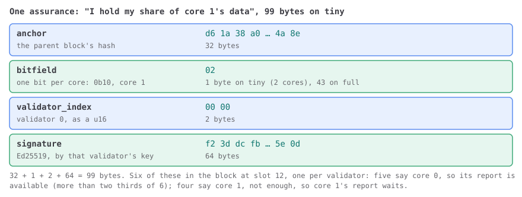

# Part 11 · Assurances

**In one sentence:** before JAM acts on a report, the data behind it has to be spread
among the validators, and this part counts their word that it is.

A report on a core is a promise that some work is done. Every block, validators say
which cores' data they hold. This part counts those assurances, makes reports available,
clears out the ones that waited too long, and refuses assurances that break the rules.

By the end of this part your client counts assurances, makes reports available, clears
the ones that waited too long, and handles every assurances vector, tiny and full.

## The big picture

A core's three guarantors have refined a package and signed a report ([Part
12](../12-guarantees/index.md) checks that). The chain still can't act on it. The report
is small. The data behind it, the package, its payloads and what refine exported, is
big, and so far it lives on three machines. If those three vanished, nobody could audit
the work or build on it.

So before a report counts, its data is spread out. The guarantors erasure-code it into
one shard per validator ([lesson 3.3](../03-work-and-reports/03-a-work-report.md)) and
send each validator its shard. Every validator that has its shard says so in the next
block. That saying-so is an *assurance*: one small signed record per validator per
block.

The paper tells the same journey at the start of §11, and says why a block deals with the
assurances before the guarantees, though a report meets them the other way round:

::: gray-paper 11

#### §11 Reporting and Assurance {#gp-11}

Reporting and assurance are the two on-chain processes we do to allow the results of <abbr class="gp-term" title="done by a core's guarantors, off the chain; the chain only sees the result">in-core</abbr> computation to make their way into the state of service accounts, $\delta$. A *work-package*, which comprises several *work-items*, is transformed by validators acting as *guarantors* into its corresponding *work-report*, which similarly comprises several *work-digests* and then presented on-chain within the *guarantees* extrinsic. At this point, the work-package is erasure coded into a multitude of segments and each segment distributed to the associated validator who then attests to its availability through an *assurance* placed on-chain. After enough assurances the work-report is considered *available*, and the work-digests transform the state of their associated service by virtue of accumulation, covered in section [12](../17-accumulation/index.md#gp-12-p1). The report may also be *timed-out*, implying it may be replaced by another report without accumulation.

From the perspective of the work-report, therefore, the guarantee happens first and the assurance afterwards. However, from the perspective of a block's state-transition, the assurances are best processed first since each core may only have one *<abbr class="gp-term" title="a guaranteed report waiting on its core until enough validators hold its pieces">availability assignment</abbr>* (a guaranteed work-report pending availability). Thus, we will first cover the transition arising from processing the availability assurances followed by the work-report guarantees. This synchroneity can be seen formally through the requirement of an intermediate state $\rho^\ddagger$, utilized later in equation [11.32](../12-guarantees/04-bad-guarantees.md#eq-11-32).

:::

So a block's import frees the cores first (this part), then fills them ([Part
12](../12-guarantees/index.md)). §11.2 names the two things this part computes, ρ‡ and 𝐑:

::: gray-paper 11.2

#### §11.2 Package Availability Assurances {#gp-11-2}

We first define $\rho^\ddagger$, the intermediate state to be utilized next in section [11.4](../12-guarantees/index.md#gp-11-4-p1), as well as $\mathbf{R}$, the set of available work-reports, which we will utilize later in section [12](../17-accumulation/index.md#gp-12-p1). Both require the integration of information from the assurances extrinsic $\mathbf{E}_A$.

:::

Who does what, and where:

1. **In-core**, the guarantors split the data into one shard per validator, 6 on tiny and
   1,023 on full, and send them out. Not your client's job.
2. **Off the chain**, a validator that received its shard signs an assurance: the parent
   block's hash, one bit per core it holds data for, its index. Not your client's job
   either: a block importer makes no assurances.
3. **On the chain**, every validator counts. For each core, how many assurances in this
   block have its bit set? More than two thirds of the validators (5 of 6 on tiny, 683 of
   1,023 on full), and the core's report is *available*: it leaves the core and goes on to
   accumulation ([Part 17](../17-accumulation/index.md)). That's your client, in
   [11.1](./01-available.md).
4. A report that isn't available after 5 slots is dropped and its core freed
   ([11.2](./02-timeouts.md)). An assurance that breaks a rule refuses its whole block
   ([11.3](./03-bad-assurances.md)).

Why two thirds: the erasure code rebuilds the data from any third of the shards. If more
than two thirds of the validators hold theirs, then even with a third of them dishonest,
honest validators hold enough to rebuild it.

The nearest thing you may know is a storage system that won't acknowledge a write until
enough replicas confirm they hold it. The report is the write, the assurances are the
acknowledgements, and two thirds is the quorum.

**Builds on** [Part 3 · Work and reports](../03-work-and-reports/index.md), [Part 4 ·
Blocks](../04-blocks/index.md), [Part 5 · Hashing and
signatures](../05-hashing-and-signatures/index.md) and [Part 10 ·
Disputes](../10-disputes/index.md), and on the foundations every part uses, [Parts 0 to
2](../index.md#lessons).

## At a glance

The whole part on one map. Boxes are what your client holds, and rounded cards are the
steps between them; a dashed card happens outside your client. Tap any card, or walk
through them in order with *next*.

<PartFlow :part="11" />

**Starting here?** At the repo root, `npm run catch-up -- 10.5` makes your client the one
this part starts from; [How to read it](../index.md#how-to-read-it) says more.

- [11.1 Available](./01-available.md)
- [11.2 Timeouts](./02-timeouts.md)
- [11.3 Bad assurances](./03-bad-assurances.md)

## In the Gray Paper

Open **§11.2, *Package Availability Assurances***, and **§11.1, *State***, for ρ; §11's two opening paragraphs say why a block handles assurances before guarantees.

| The paper says | We say | The vectors say |
| --- | --- | --- |
| ρ, the availability assignments: for each core, a guarantee 𝐠 and the slot t it arrived, or nothing (∅); ρ† after disputes, ρ‡ after assurances, ρ′ after guarantees | the pending reports on the cores, and the dagger states | `avail_assignments`, each a `guarantee` and its `registered_slot` |
| an assurance: anchor a, availabilities f (a bitstring, one bit per core), assurer v, signature s; X_A, the context `$jam_available` | the parent hash, the bitfield, the validator index, the signature | `anchor`, `bitfield`, `validator_index`, `signature` |
| 𝐑, the newly available reports; U = 5, the assurance timeout | the available reports; the timeout | `output.reported` |

Its defining lines, (11.11) and (11.17), each explained symbol by symbol, with the rest of the part's formulas, in [11.A](./gray-paper.md):

::: gray-paper-eq 11.11

The Gray Paper's (11.11), [in its place in the paper's words](./01-available.md#eq-11-11):

$$
\begin{align}
\mathbf{E}_A \in \left[\!\left[\!\left\lgroup
a\in \mathbb{H}_{},\,
f\in \mathbb{b}_{\mathsf{C}},\,
v\in \mathbb{N}_{\left\vert\kappa\right\vert},\,
s\in \bar{\mathbb{V}}
\right\rgroup\!\right]\!\right]_{} \tag{11.11}
\end{align}
$$

Its symbols

| Symbol | Say it | Means |
| --- | --- | --- |
| $\mathbf{E}_A$ | E sub A | the assurances bag: validators saying they hold their pieces of reports |
| [$\in$](../symbols.md#in) | in | belongs to: x ∈ ℕ says x is a whole number; in a type line, the value's type |
| [$\left[\!\left[x\right]\!\right]$](../symbols.md#sequence) | a sequence of | ⟦T⟧ is an array of T; a subscript is its length, :n at most n, n: at least n |
| $\!\left\lgroup x\right\rgroup\!$ | the tuple of | a record: named fields, each with its type, like an object in JSON |
| [$x\in y$](../symbols.md#in) | in | belongs to: the field's type |
| $a$ | a | an assurance's anchor: the parent block's header hash |
| $\mathbb{H}$ | H | a 32-byte value, usually a hash |
| $f$ | f | an assurance's bitfield: one bit per core, 1 for "I hold my piece of its data" |
| $\mathbb{b}$ | b sub n | bits: a run of true-or-false values; a subscript is how many |
| $\mathsf{C}$ | C | the number of cores: 341 on full, 2 on tiny |
| $v$ | v | the assuring validator's index in κ |
| [$\mathbb{N}_{x}$](../symbols.md#naturals) | N sub n | the whole numbers below n: ℕ_C is a core index, 0 to C − 1 |
| $\left\vert x\right\vert$ | the size of | \|x\|: how many items x has, or how many bytes |
| $\kappa$ | kappa | the current validators: the keys of the V validators active this epoch |
| $s$ | s | the assurer's Ed25519 signature over the parent hash and the bitfield |
| $\bar{\mathbb{V}}$ | V bar | an Ed25519 signature: 64 bytes |

:::

::: gray-paper-eq 11.17

The Gray Paper's (11.17), [in its place in the paper's words](./01-available.md#eq-11-17):

$$
\begin{align}
\mathbf{R} &\equiv \left[
(\rho^\dagger\left[c\right]_{\mathbf{g}})_{\mathbf{r}}
\;\middle\vert\;
c \mathrel{\unicode{x2B40}} \mathbb{N}_{\mathsf{C}},\;
\sum_{a \in \mathbf{E}_A}\!a_{f}\left[c\right]\,>\,{}^{2}\!/_{3}\,\left\vert\kappa\right\vert
\right] \tag{11.17}
\end{align}
$$

Its symbols

| Symbol | Say it | Means |
| --- | --- | --- |
| $\mathbf{R}$ | R | the reports this block made available: ready to accumulate |
| [$\equiv$](../symbols.md#defined-as) | is defined as | the left side is, by definition, the right: a definition, not a test |
| [$\left[x\right]$](../symbols.md#sequence) | the sequence | a sequence written out item by item; [ ] is the empty one |
| $\left\{ x \;\middle\vert\; y \right\}$ | for each, such that | built by a rule: the left-hand value, for every case the right-hand side allows (a set, or a sequence in order) |
| $\rho^\dagger$ | rho dagger | the pending reports midway: after disputes took the judged-bad ones out |
| $c$ | c | a core's index, 0 to C − 1 |
| $\mathbf{g}$ | bold g | the guarantee a core's pending report came with: the report and its guarantors' signatures |
| $\mathbf{r}$ | r | a guarantee's work-report: 𝐠_𝐫 is the report it vouches for |
| $\mathrel{\unicode{x2B40}}$ | in order, from | each item of the sequence, in its order |
| $\mathbb{N}_{\mathsf{C}}$ | N sub C | the core indices: 0 to C − 1 |
| $\sum$ | the sum of | add up what follows, once for each value the subscript ranges over |
| ${}^{2}\!/_{3}$ | two thirds | two thirds: ⌊⅔ · 6⌋ + 1 is 5 judgments on tiny, 683 of 1,023 on full |

:::

Read it aloud: "the assurances extrinsic is a sequence of tuples: a, a hash; f, a
bitstring of C bits; v, a validator index below the number of validators; and s, an
Ed25519 signature. 𝐑, the newly available reports, is defined as the sequence of the
report of ρ dagger at c, for each core c in order, such that the sum over the assurances
of core c's bit is more than two thirds of the validator count." The square bracket with
a bar in it is a sequence comprehension: "the list of these, for each c such that".
Everything else in §11.2 is the five rules of [11.3](./03-bad-assurances.md) and the
timeouts of [11.2](./02-timeouts.md).

**Test yourself:** [Ch. 11 Reporting and Assurance](https://abutlabs.github.io/jam-learning/lasair/exam.html?chapter=ch11-reporting-assurance),
self-test cards on JAM learning.
