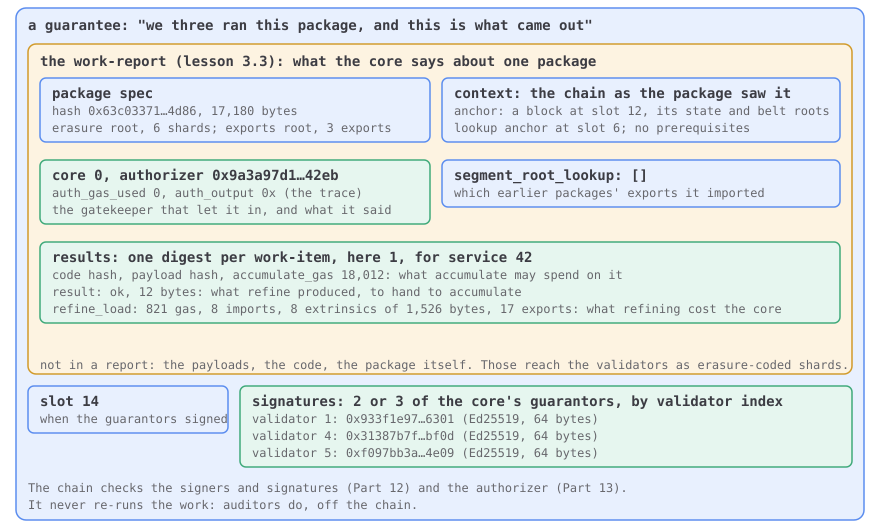

# Part 12 · Guarantees

A work-report gets onto a core only with guarantors behind it: validators assigned to
that core who ran the work and signed the result. This part deals out the guarantor
assignments, checks the guarantees' signatures, and puts new reports on free cores.

By the end of this part your client assigns guarantors, checks guarantees and reports,
and accepts or refuses every reports vector exactly as it should.

## The big picture

A work-report is the chain's only view of the work done on a core. Three validators ran
the package in-core; the other 1,020 didn't, and never will. A *guarantee* is how those
three put their stake behind what they saw: the report, the slot, and their signatures.
This part is the chain's side of that bargain: deciding which three validators are each
core's guarantors, so nobody picks their own, checking that each guarantee carries their
signatures, and seating each report on its core.

The paper defines it at the start of §11.4, in one line:

::: gray-paper 11.4 1-2

#### §11.4 Work Report Guarantees {#gp-11-4}

We begin by defining $\mathbb{G}$, the set of *guarantees*. A guarantee is a tuple of a *work-report* $\mathbf{r}$, a credential $a$ and its corresponding timeslot $t$. The credential is a sequence of two or three tuples of a unique validator index and a signature. Formally:

$$
\begin{equation}
\mathbb{G} \equiv \!\left\lgroup
\mathbf{r}\in \mathbb{R},\,
t\in \mathbb{N}_T,\,
a\in \left[\!\left[\!\left\lgroup\mathbb{N}, \bar{\mathbb{V}}\right\rgroup\!\right]\!\right]_{2:3}
\right\rgroup\! \tag{11.24}
\end{equation}
$$

Its symbols, in plain words

| Symbol | Say it | Means |
| --- | --- | --- |
| $\mathbb{G}$ | G | the set of guarantees: a work-report, the slot it was made at, and two or three guarantors' signatures |
| [$\equiv$](../symbols.md#defined-as) | is defined as | the left side is, by definition, the right: a definition, not a test |
| $\!\left\lgroup x\right\rgroup\!$ | the tuple of | a record: named fields, each with its type, like an object in JSON |
| [$x\in y$](../symbols.md#in) | in | belongs to: the field's type |
| $\mathbf{r}$ | r | a guarantee's work-report: 𝐠_𝐫 is the report it vouches for |
| $\mathbb{R}$ | R | the set of work-reports: a core's signed receipt for one work-package |
| $t$ | t | a guarantee's timeslot: the slot its guarantors signed it in |
| $\mathbb{N}_T$ | N sub T | a timeslot: a u32 counting 6-second slots |
| $a$ | a | a guarantee's credential: two or three pairs of a validator index and its Ed25519 signature |
| [$\left[\!\left[x\right]\!\right]$](../symbols.md#sequence) | a sequence of | ⟦T⟧ is an array of T; a subscript is its length, :n at most n, n: at least n |
| [$\mathbb{N}$](../symbols.md#naturals) | N | the whole numbers: 0, 1, 2 and up; a subscript is a bound, ℕ₈ is 0 to 7 |
| $\bar{\mathbb{V}}$ | V bar | an Ed25519 signature: 64 bytes |

→ [(11.24) in plain words](./gray-paper.md#ex-11-24)

:::

Who does what, and where:

1. **On the chain**, every validator deals the guarantors: the validator set shuffled with
   the epoch's entropy, three to a core, re-dealt every rotation of a few slots
   ([12.1](./01-who-guarantees-what.md)). Everyone gets the same hand because everyone has
   the same entropy.
2. **In-core**, those three take a package in, run its authorizer and refine its items on
   the PVM ([Part 15](../15-the-pvm/index.md)'s machine, which your client never runs for
   this), build the report, and each signs it. Two signatures are enough; three is normal.
3. **On the chain**, every validator checks each guarantee in the block: the signatures
   are real and by the dealt guarantors ([12.2](./02-signed-and-counted.md),
   [12.4](./04-bad-guarantees.md)), the report is sensible and anchored on a block the
   chain remembers ([12.5](./05-bad-reports.md)), and its authorizer is in the core's pool
   ([12.4](./04-bad-guarantees.md), [Part 13](../13-authorization/index.md)). Then the
   report takes its core ([12.3](./03-onto-the-cores.md)) and waits for assurances ([Part
   11](../11-assurances/index.md)).

The nearest thing you may know is a receipt countersigned by three workers. The chain is
the accounts department: it checks who signed and that the paperwork is in order, and it
never redoes the work. Auditors do that, off the chain, and [Part
10](../10-disputes/index.md) is what happens when they catch a lie.

**Builds on** [Part 3 · Work and reports](../03-work-and-reports/index.md), [Part 4 ·
Blocks](../04-blocks/index.md), [Part 5 · Hashing and
signatures](../05-hashing-and-signatures/index.md), [Part 6 · State and
Merklization](../06-state-and-merklization/index.md), [Part 7 · Time and
shuffling](../07-time-and-shuffling/index.md), [Part 8 · Safrole](../08-safrole/index.md),
[Part 9 · Recent history](../09-recent-history/index.md) and [Part 10 ·
Disputes](../10-disputes/index.md), and on the foundations every part uses, [Parts 0 to
2](../index.md#lessons).

## At a glance

The whole part on one map. Boxes are what your client holds, and rounded cards are the
steps between them; a dashed card happens outside your client. The bands say where each
step runs: the chain deals the guarantors, the guarantors work in-core, and the chain
checks what they signed. Tap any card, or walk through them in order with *next*.

<PartFlow :part="12" />

**Starting here?** At the repo root, `npm run catch-up -- 11.3` makes your client the one
this part starts from; [How to read it](../index.md#how-to-read-it) says more.

- [12.1 Who guarantees what](./01-who-guarantees-what.md)
- [12.2 Signed and counted](./02-signed-and-counted.md)
- [12.3 Onto the cores](./03-onto-the-cores.md)
- [12.4 Bad guarantees](./04-bad-guarantees.md)
- [12.5 Bad reports](./05-bad-reports.md)

## In the Gray Paper

Open **§11.3, *Guarantor Assignments***, for who guarantees which core; **§11.4, *Work Report Guarantees***, with **§11.4.1, *Contextual Validity of Reports***, for the guarantee and every rule it and its report must keep; and **§11.5, *Transitioning for Reports***, for seating the reports. **§15, *Guaranteeing***, is what a guarantor does in-core (not a block importer's job).

| The paper says | We say | The vectors say |
| --- | --- | --- |
| a guarantee 𝔾 ≡ (𝐫 report, t timeslot, a credential: two or three (validator index, signature) pairs); X_G, the context `$jam_guarantee` | the report, the slot, the signatures | `report`, `slot`, `signatures` with `validator_index`, `signature` |
| 𝐌, the guarantor assignments: a core for each validator, and the validators' keys, offenders blanked; 𝐌\*, the same for the rotation before; R, the rotation period: 10 slots on full, 4 on tiny | the dealt hand: three validators a core | |
| 𝐆, the reporters: every key that signed a guarantee in the block | the reporters | |
| 𝐈, the incoming reports: the block's guaranteed reports | the reports to seat | |

Its defining lines, (11.24) and the rule that joins [Parts 11](../11-assurances/index.md), 12 and [13](../13-authorization/index.md), (11.32), each explained symbol by symbol, with every other formula of the part, in [12.A](./gray-paper.md):

::: gray-paper-eq 11.24

The Gray Paper's (11.24), [in its place in the paper's words](#eq-11-24):

$$
\begin{equation}
\mathbb{G} \equiv \!\left\lgroup
\mathbf{r}\in \mathbb{R},\,
t\in \mathbb{N}_T,\,
a\in \left[\!\left[\!\left\lgroup\mathbb{N}, \bar{\mathbb{V}}\right\rgroup\!\right]\!\right]_{2:3}
\right\rgroup\! \tag{11.24}
\end{equation}
$$

:::

::: gray-paper-eq 11.32

The Gray Paper's (11.32), [in its place in the paper's words](./04-bad-guarantees.md#eq-11-32):

$$
\begin{equation}
\forall \mathbf{r} \in \mathbf{I} :
\rho^\ddagger\left[\mathbf{r}_{c}\right] = \emptyset \wedge \mathbf{r}_{a} \in \alpha\left[\mathbf{r}_{c}\right] \tag{11.32}
\end{equation}
$$

Its symbols, in plain words

| Symbol | Say it | Means |
| --- | --- | --- |
| $\forall$ | for all | for every value: ∀c ∈ ℕ_C means for each core c |
| [$\in$](../symbols.md#in) | in | belongs to: x ∈ ℕ says x is a whole number; in a type line, the value's type |
| $\mathbf{I}$ | I | the incoming reports: the work-reports this block's guarantees carry |
| $\rho^\ddagger$ | rho double dagger | the pending reports midway: after the available ones and the timed-out ones left |
| [$\left[x\right]$](../symbols.md#sequence) | at | x[i]: the item at index i, or the value at key i |
| $c$ | c | the core a report's work was done on, 0 to C − 1 |
| $\emptyset$ | nothing | ∅: no value at all, like null |
| $\wedge$ | and | both sides are true |
| $\alpha$ | alpha | the authorizer pools: for each core, up to O = 8 authorizer hashes it accepts right now |

:::

Read it aloud: "a guarantee is defined as a tuple of: r, a work-report; t, a timeslot; and
a, a credential, a sequence of two to three pairs of a natural (the validator index) and
a signature. For every incoming report r: rho double-dagger at r's core is nothing, and
r's authorizer is in alpha at r's core." The first half is why a core holds one report at
a time ([12.3](./03-onto-the-cores.md)): it must be empty after the assurances. The second
is [Part 13](../13-authorization/index.md)'s whole reason to exist, checked here in
[12.4](./04-bad-guarantees.md).

**Test yourself:** [Ch. 11 Reporting and Assurance](https://abutlabs.github.io/jam-learning/lasair/exam.html?chapter=ch11-reporting-assurance),
self-test cards on JAM learning.
