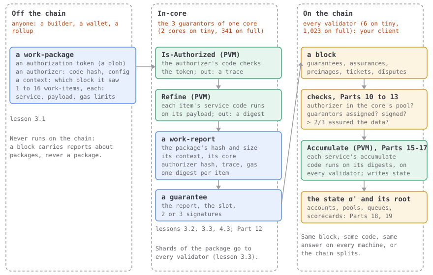

# What runs where

Optional, and no code. If you are comfortable passing JSON between services, but this
tutorial is your first time down at the level of bytes, this page is the map to keep
open. JAM has three places where things happen, about a dozen kinds of object that pass
between them, and two kinds of code. Every lesson is about one object in one place.
Nothing here needs to stick yet: each piece comes back in its own lesson, linked.

## Three places

| Place | Who is there | What runs there | Your client? |
| --- | --- | --- | --- |
| **Off the chain** | anyone: a wallet, a rollup, a builder | someone puts work into a *work-package* and hands it to a core's guarantors | no |
| **In-core** | the three *guarantors* of one core, this rotation ([12.1](./12-guarantees/01-who-guarantees-what.md)) | the package's *authorizer* runs (Is-Authorized), then each item's service code (*Refine*), both in the PVM; the result is a signed *work-report* | no: block import never runs it, but [Part 12](./12-guarantees/index.md) checks the signatures |
| **On the chain** | every validator, 6 on tiny and 1,023 on full; your client is one | importing the block: the checks of [Parts 10](./10-disputes/index.md) to [13](./13-authorization/index.md), then each service's accumulate code (*Accumulate*), in the PVM again, then the new state and its root | yes: [Parts 8](./08-safrole/index.md) to [19](./19-block-import/index.md) |

The rule that makes the places matter: whatever runs on the chain runs on every
validator, so it must be cheap and give the same answer everywhere. Whatever is heavy
runs in-core, on three machines, and the chain only ever sees the result and who signed
for it. A core isn't a machine. It's a lane of work, and a different three validators
staff it every rotation.

The paper draws the same split in §4.9, and names the two models:

::: gray-paper 4.9

#### §4.9 The Core Model and Services {#gp-4-9}

Whereas in the Ethereum Yellow Paper when defining the state machine which is held in consensus amongst all network participants, we presume that all machines maintaining the full network state and contributing to its enlargement—or, at least, hoping to—evaluate all computation. This “everybody does everything” approach might be called the *on-chain consensus model*. It is unfortunately not scalable, since the network can only process as much logic in consensus that it could hope any individual node is capable of doing itself within any given period of time.

:::

::: gray-paper 4.9.1

#### §4.9.1 In-core Consensus {#gp-4-9-1}

In the present work, we achieve scalability of the work done through introducing a second model for such computation which we call the *<abbr class="gp-term" title="done by a core's guarantors, off the chain; the chain only sees the result">in-core</abbr> consensus model*. In this model, and under normal circumstances, only a subset of the network is responsible for actually executing any given computation and assuring the availability of any input data it relies upon to others. By doing this and assuming a certain amount of computational parallelism within the validator nodes of the network, we are able to scale the amount of computation done in consensus commensurate with the size of the network, and not with the computational power of any single machine. In the present work we expect the network to be able to do upwards of 300 times the amount of computation *in-core* as that which could be performed by a single machine running the virtual machine at full speed.

Since in-core consensus is not evaluated or verified by all nodes on the network, we must find other ways to become adequately confident that the results of the computation are correct, and any data used in determining this is available for a practical period of time. We do this through a crypto-economic game of three stages called *guaranteeing*, *assuring*, *auditing* and, potentially, *judging*. Respectively, these attach a substantial economic cost to the invalidity of some proposed computation; then a sufficient degree of confidence that the inputs of the computation will be available for some period of time; and finally, a sufficient degree of confidence that the validity of the computation (and thus enforcement of the first guarantee) will be checked by some party who we can expect to be honest.

All execution done in-core must be reproducible by any node synchronized to the portion of the chain which has been <abbr class="gp-term" title="voted final by GRANDPA: never undone">finalized</abbr>. Execution done in-core is therefore designed to be as stateless as possible. The requirements for doing it include only the refinement code of the service, the code of the authorizer and any preimage lookups it carried out during its execution.

When a work-report is presented on-chain, a specific block known as the *<abbr class="gp-term" title="the block whose state an in-core run's lookups saw; it must be final and recent">lookup-anchor</abbr>* is identified. Correct behavior requires that this must be in the finalized chain and reasonably recent, both properties which may be proven and thus are acceptable for use within a consensus protocol.

We describe this pipeline in detail in the relevant sections later.

:::

On Ethereum every node runs every transaction, so the network can do no
more than one node can. JAM lets a few validators do each piece of work, in-core, and
makes that safe in stages (the paper says three, then names four): the guarantors stake their reputation on a report, the
assurers keep its data where anyone can fetch it, the auditors redo it, and if they
disagree, the judges settle it on the chain. In-core work can only use what it's handed
(its code, its inputs, the preimages it looks up), so anyone can redo it later. The
lookup anchor is the block whose state those lookups saw. The four stages are §15 to
§17, quoted [at the end of this page](#off-the-chain-in-the-gray-paper).

## The objects, and what each is made from

| Object | Made from | Made by | Checked or used | Lesson |
| --- | --- | --- | --- | --- |
| **Work-item** | a service id, a payload (the input bytes), gas limits for refine and accumulate, and what it imports and exports | whoever builds the package | refined in-core; its digest accumulated on the chain | [3.1](./03-work-and-reports/01-a-work-package.md) |
| **Work-package** | an authorization token, an authorizer (a code hash and a configuration blob, with the service that holds the code), a context (which block it saw), and 1 to 16 work-items | a builder, off the chain | taken in by a core's guarantors; never in a block | [3.1](./03-work-and-reports/01-a-work-package.md) |
| **Authorizer** | a PVM program (named by its code hash) plus a configuration blob; its name is the hash of the two together | whoever writes the program; the core's assigner service puts its hash in that core's queue | run in-core on the package and its token; its hash must be in the core's pool, checked on the chain | [13.1](./13-authorization/01-the-authorizer-pools.md) |
| **Work digest** | what refining one item produced: a result (an output, or an error), with the item's service, code hash, payload hash and gas | the guarantors, in-core | handed to the service's accumulate code | [3.2](./03-work-and-reports/02-work-digests.md) |
| **Work-report** | the package's hash and size, its context, its core, the authorizer's hash, trace and gas, one digest per item | the guarantors, in-core | checked on the chain ([Parts 12](./12-guarantees/index.md) and [13](./13-authorization/index.md)), then waits for assurances | [3.3](./03-work-and-reports/03-a-work-report.md) |
| **Guarantee** | a work-report, the slot, and two or three guarantors' signatures | the guarantors | one of a block's five extrinsics | [4.3](./04-blocks/03-guarantees.md), [Part 12](./12-guarantees/index.md) |
| **Assurance** | the parent block's hash, one bit per core, a validator's index and signature | each validator, for the cores whose data it holds | counted on the chain: more than two thirds, and the report is available | [Part 11](./11-assurances/index.md) |
| **Preimage** | bytes filed under their hash: a service's code is one | anyone who has the bytes, in a block's preimages extrinsic | a service asks by hash and length, and reads it with a host call | [14.1](./14-services/01-providing-preimages.md), [16.8](./16-host-calls/08-lookup.md) |
| **Service** | an account in the state, and one PVM program with two entry points, refine and accumulate | created by another service, with `new` | refines in-core, accumulates on the chain | [14.2](./14-services/02-the-service-account.md), [17.8](./17-accumulation/08-creating-a-service.md) |
| **Service account** | a record (code hash, balance, gas minimums, footprint) and three bags of entries: storage, preimages, requests | the chain, as the service's code asks | read and written only by that service's accumulate code and the preimages extrinsic | [14.2](./14-services/02-the-service-account.md) |
| **Block** | a header and five extrinsics: tickets, preimages, guarantees, assurances, disputes | the slot's author | every validator imports it | [4.7](./04-blocks/07-the-block.md) |
| **State** | the chain's memory: validators, entropy, every service's account, the cores' pools and queues, the scorecards | the state transition, on every validator | its root is in the next header, so one wrong byte refuses a block | [6.3](./06-state-and-merklization/03-reading-the-state.md), [19.2](./19-block-import/02-the-whole-state.md) |

## Two kinds of code, and a third

A service is one program with two entry points. The authorizer is a program of its own.
Each runs in a different place, with different rights:

| Entry point | Runs where | Run by | Reads | Can change | Gas, on full |
| --- | --- | --- | --- | --- | --- |
| **Is-Authorized** | in-core | the core's guarantors, then auditors | the package, its token, its configuration | nothing: it answers yes with a trace, or no | 50,000,000 a package |
| **Refine** | in-core | the core's guarantors, then auditors | its payload, preimages as the lookup anchor saw them, imported segments | nothing on the chain: it makes a digest | 5,000,000,000 a package |
| **Accumulate** | on the chain | every validator, your client included | its digests, its account, any account's record and preimages | its own storage, balance and requests; privileges, if it holds them | 10,000,000 a report |

Block import never runs the first two. It trusts the guarantors' signatures, and relies on
auditors, off the chain, to catch a core that lied; [Part 10](./10-disputes/index.md) is
what happens when they do.

§4.9.2 is the paper's reason for the two entry points, and for coretime:

::: gray-paper 4.9.2

#### §4.9.2 On Services and Accounts {#gp-4-9-2}

In *YP* Ethereum, we have two kinds of accounts: *contract accounts* (whose actions are defined deterministically based on the account's associated code and state) and *simple accounts* which act as gateways for data to arrive into the world state and are controlled by knowledge of some secret key. In JAM, all accounts are *service accounts*. Like Ethereum's contract accounts, they have an associated balance, some code and state. Since they are not controlled by a secret key, they do not need a nonce.

The question then arises: how can external data be fed into the world state of JAM? And, by extension, how does overall payment happen if not by deducting the account balances of those who sign transactions? The answer to the first lies in the fact that our service definition actually includes *multiple* code entry-points, one concerning *refinement* and the other concerning *accumulation*. The former acts as a sort of high-performance stateless processor, able to accept arbitrary input data and distill it into some much smaller amount of output data, which together with some metadata is known as a *digest*. The latter code is more stateful, providing access to certain on-chain functionality including the possibility of transferring balance and invoking the execution of code in other services. Being stateful this might be said to more closely correspond to the code of an Ethereum contract account.

To understand how JAM breaks up its service code is to understand JAM's fundamental proposition of generality and scalability. All data extrinsic to JAM is fed into the refinement code of some service. This code is not executed *on-chain* but rather is said to be executed *in-core*. Thus, whereas the accumulator code is subject to the same scalability constraints as Ethereum's contract accounts, refinement code is executed off-chain and subject to no such constraints, enabling JAM services to scale dramatically both in the size of their inputs and in the complexity of their computation.

While refinement and accumulation take place in consensus environments of a different nature, both are executed by the members of the same validator set. The JAM protocol through its rewards and penalties ensures that code executed *in-core* has a comparable level of crypto-economic security to that executed *on-chain*, leaving the primary difference between them one of scalability versus synchroneity.

As for managing payment, JAM introduces a new abstraction mechanism based around Polkadot's Agile Coretime. Within the Ethereum transactive model, the mechanism of account authorization is somewhat combined with the mechanism of purchasing blockspace, both relying on a cryptographic signature to identify a single “transactor” account. In JAM, these are separated and there is no such concept of a “transactor”.

In place of Ethereum's gas model for purchasing and measuring blockspace, JAM has the concept of *<abbr class="gp-term" title="time on a core, bought ahead: the right to have work run there for a while">coretime</abbr>*, which is prepurchased and assigned to an authorization agent. Coretime is analogous to gas insofar as it is the underlying resource which is being consumed when utilizing JAM. Its procurement is out of scope in the present work and is expected to be managed by a system <abbr class="gp-term" title="a chain of its own whose blocks Polkadot's validators check, one core's worth at a time">parachain</abbr> operating within a parachains service itself blessed with a number of cores for running such system services. The authorization agent allows external actors to provide input to a service without necessarily needing to identify themselves as with Ethereum's transaction signatures. They are discussed in detail in section [8](./13-authorization/index.md#gp-8-p1).

:::

There are no user accounts with private keys, only services, each a
balance, code and storage. Data comes in from outside only through refine, which runs
in-core and can take a lot in and boil it down to a small digest. Accumulate, on the
chain, folds the digests into the service's state, and only it can move balances or call
other services. Nobody pays per transaction: someone buys coretime, and the authorizer
decides whose work may use it ([Part 13](./13-authorization/index.md)).

## The machine both kinds of code run on

All three entry points run in the same virtual machine, the PVM. §4.7 sums it up before
Appendix A defines it:

::: gray-paper 4.7

#### §4.7 The Virtual Machine and Gas {#gp-4-7}

In the present work, we presume the definition of a *Polkadot Virtual Machine* (PVM). This virtual machine is based around the RISC-V instruction set architecture, specifically the RV64EM variant, and is the basis for introducing permissionless logic into our state-transition function.

The PVM is comparable to the EVM defined in the Yellow Paper, but somewhat simpler: the complex instructions for cryptographic operations are missing as are those which deal with environmental interactions. Overall it is far less opinionated since it alters a pre-existing general purpose design, RISC-V, and optimizes it for our needs. This gives us excellent pre-existing tooling, since PVM remains essentially compatible with RISC-V, including support from the compiler toolkit LLVM and languages such as Rust and C++. Furthermore, the instruction set simplicity which RISC-V and PVM share, together with the register size (64-bit), active number (13) and endianness (little) make it especially well-suited for creating efficient recompilers on to common hardware architectures.

The PVM is fully defined in appendix [A](./15-the-pvm/03-the-machine.md#gp-A-1-p1), but for contextualization we will briefly summarize the basic <abbr class="gp-term" title="one run of code in the PVM: Is-Authorized, refine or accumulate">invocation</abbr> function $\Psi$ which computes the resultant state of a PVM instance initialized with some registers ($\left[\!\left[\mathbb{N}_R\right]\!\right]_{13}$) and RAM ($\mathbb{M}$), within the limits of some amount of gas ($\mathbb{N}_G$), a number of approximately time-proportional computational steps:

$$
\begin{equation}
\Psi\colon
\!\left\lgroup\,
\begin{alignedat}{2}
&\mathbb{B}_{},\,\ \ &&\mathbb{N}_R\\
&\mathbb{N}_G,\,\ \ &&{\left\{\,\bot, \top\,\right\}}\\
&\left[\!\left[\mathbb{N}_R\right]\!\right]_{13},\,\ \ &&\mathbb{M}\\
\end{alignedat}
\,\right\rgroup\!
\to
\!\left\lgroup\,
\begin{aligned}
&\left\{\,\blacksquare, \unicode{x21AF}, \infty\,\right\} \cup \left\{\,\unicode{x2132},\hbar\,\right\} \times \mathbb{N}_R, \mathbb{N}_R,\\
&\mathbb{N}_G,\ \ \ {\left\{\,\bot, \top\,\right\}},\ \ \ \left[\!\left[\mathbb{N}_R\right]\!\right]_{13},\ \ \ \mathbb{M}
\end{aligned}
\,\right\rgroup\! \tag{4.22}
\end{equation}
$$

Its symbols

| Symbol | Say it | Means |
| --- | --- | --- |
| $\Psi$ | psi (capital) | the PVM: a program, a gas limit, registers and memory in; how it stopped and what's left out |
| $\!\left\lgroup x\right\rgroup\!$ | the tuple of | a record: named fields, each with its type, like an object in JSON |
| [$\mathbb{B}$](./symbols.md#blobs) | B, or B sub n | bytes: any run of them; 𝔹ₙ exactly n of them |
| $\mathbb{N}_R$ | N sub R | a register's value: a u64 |
| $\mathbb{N}_G$ | N sub G | an amount of gas: a u64 |
| ${\left\{\,\bot, \top\,\right\}}$ | true or false | a yes-or-no value: true (⊤) or false (⊥) |
| [$\left[\!\left[x\right]\!\right]$](./symbols.md#sequence) | a sequence of | ⟦T⟧ is an array of T; a subscript is its length, :n at most n, n: at least n |
| $\mathbb{M}$ | M | a PVM memory: its bytes, and which pages may be read or written |
| [$\to$](./symbols.md#to) | to | what goes in, to what comes out: A → B takes an A and gives a B |
| $\left\{\,x\,\right\}$ | the set of | a set: values with no order and no repeats |
| $\blacksquare$ | halt | ∎: the program finished normally |
| $\unicode{x21AF}$ | panic | ↯: the program trapped |
| $\infty$ | out of gas | ∞: the program ran out of gas |
| $\cup$ | union | everything in either side |
| $\unicode{x2132}$ | page fault | Ⅎ: the program touched memory it may not |
| $\hbar$ | host call | ħ: the program asked the host for something, and waits |
| $\times$ | times | multiply; between sets, every pair of one from each |

→ [(4.22) explained](./00-start/gray-paper.md#ex-4-22)

We refer to the time-proportional computational steps as *gas* (much like in the *YP*) and limit it to a 64-bit quantity. Within the context of the PVM, $\varrho \in \mathbb{N}_G$ is typically used to denote gas, but we may also use $\varrho \in \mathbb{Z}_G$ internally within the definition of the PVM where it may be convenient.

$$
\begin{equation}
\mathbb{Z}_G \equiv \mathbb{Z}_{-2^{63}\dots2^{63}}\ ,\quad
\mathbb{N}_G \equiv \mathbb{N}_{2^{64}}\ ,\quad
\mathbb{N}_R \equiv \mathbb{N}_{2^{64}} \tag{4.23}
\end{equation}
$$

Its symbols

| Symbol | Say it | Means |
| --- | --- | --- |
| $\mathbb{Z}_G$ | Z sub G | gas that can go negative: an i64 |
| [$\equiv$](./symbols.md#defined-as) | is defined as | the left side is, by definition, the right: a definition, not a test |
| $\mathbb{Z}$ | Z | the integers, negative ones too; a subscript gives the range |
| [$\mathbb{N}_{2^{x}}$](./symbols.md#naturals) | N sub two to the n | the numbers that fit in n bits: ℕ_{2³²} is a u32 |

→ [(4.23) explained](./00-start/gray-paper.md#ex-4-23)

It is left as a rather important implementation detail to ensure that the amount of time taken while computing the function $\Psi(\dots, \varrho, \dots)$ has a maximum computation time approximately proportional to the value of $\varrho$ regardless of other operands.

The PVM is a very simple RISC *register machine* and as such has 13 registers, each of which is a 64-bit quantity, denoted as $\mathbb{N}_R$, a natural less than $2^{64}$.1 Within the context of the PVM, $\varphi \in \left[\!\left[\mathbb{N}_R\right]\!\right]_{13}$ is typically used to denote the registers.

<small class="gp-note">1 This is three fewer than RISC-V's 16, however the amount that program code output by compilers uses is 13 since two are reserved for operating system use and the third is fixed as zero</small>

$$
\begin{align}
\mathbb{M} &\equiv \!\left\lgroup
\mathbf{v}\in \mathbb{B}_{2^{32}},
\mathbf{a}\in \left[\!\left[\left\{\,\text{W}, \text{R}, \emptyset\,\right\}\right]\!\right]_{p}
\right\rgroup\!\,,\ p = \frac{2^{32}}{\mathsf{Z}_P} \tag{4.24} \\
\mathsf{Z}_P &= 2^{12} \tag{4.25}
\end{align}
$$

Its symbols

| Symbol | Say it | Means |
| --- | --- | --- |
| [$x\in y$](./symbols.md#in) | in | belongs to: the field's type |
| $\mathbf{v}$ | v | memory's bytes |
| $\mathbf{a}$ | a | memory's access: for each page, readable, writable or neither |
| $\emptyset$ | nothing | ∅: no value at all, like null |
| $\frac{x}{y}$ | over | a fraction: the top divided by the bottom |
| $\mathsf{Z}_P$ | Z sub P | a memory page: 4,096 bytes |

→ [(4.24), (4.25) explained](./00-start/gray-paper.md#ex-4-24)

The PVM assumes a simple pageable RAM of 32-bit addressable <abbr class="gp-term" title="bytes: 8 bits each">octets</abbr> situated in pages of $\mathsf{Z}_P = 4096$ octets where each page may be either immutable, mutable or inaccessible. The RAM definition $\mathbb{M}$ includes two components: a value $\mathbf{v}$ and access $\mathbf{a}$. If the component is unspecified while being subscripted then the value component may be assumed. Within the context of the virtual machine, $\mu \in \mathbb{M}$ is typically used to denote RAM.

$$
\begin{align}
\mathbb{V}_{\mu} &\equiv \left\{\,i \;\middle\vert\; \mu_{\mathbf{a}}\left[\left\lfloor{}^{i}\!/_{\mathsf{Z}_P}\right\rfloor\right] \ne \emptyset\,\right\} \tag{4.26} \\
\mathbb{V}_{\mu}^* &\equiv \left\{\,i \;\middle\vert\; \mu_{\mathbf{a}}\left[\left\lfloor{}^{i}\!/_{\mathsf{Z}_P}\right\rfloor\right] = \text{W} \,\right\} \tag{4.27}
\end{align}
$$

Its symbols

| Symbol | Say it | Means |
| --- | --- | --- |
| $\mathbb{V}_{x}$ | V sub mu | the addresses of memory μ that may be read |
| $\mu$ | mu | the PVM's memory |
| $\left\{ x \;\middle\vert\; y \right\}$ | for each, such that | built by a rule: the left-hand value, for every case the right-hand side allows (a set, or a sequence in order) |
| [$\left[x\right]$](./symbols.md#sequence) | at | x[i]: the item at index i, or the value at key i |
| [$\left\lfloor x\right\rfloor$](./symbols.md#floor) | floor of | rounded down to a whole number |
| ${}^{x}\!/_{y}$ | over | a fraction: the top divided by the bottom |
| $\ne$ | is not | not equal |
| $\mathbb{V}_{x}^*$ | V sub mu star | the addresses of memory μ that may be written |

→ [(4.26), (4.27) explained](./00-start/gray-paper.md#ex-4-26)

We define two sets of indices for the RAM $\mu$: $\mathbb{V}_{\mu}$ is the set of indices which may be read from; and $\mathbb{V}_{\mu}^*$ is the set of indices which may be written to.

Invocation of the PVM has an exit-reason as the first item in the resultant tuple. It is either:

- Regular program termination caused by an explicit halt instruction, $\blacksquare$.
- Irregular program termination caused by some exceptional circumstance, $\unicode{x21AF}$.
- Exhaustion of gas, $\infty$.
- A page fault (attempt to access some address in RAM which is not accessible), $\unicode{x2132}$. This includes the address of the page at fault.
- An attempt at progressing a host-call, $\hbar$. This allows for the progression and integration of a context-dependent state-machine beyond the regular PVM.

The full definition follows in appendix [A](./15-the-pvm/03-the-machine.md#gp-A-1-p1).

:::

The PVM is a stripped-down RISC-V, the instruction set many real CPUs use,
so ordinary compilers can target it. A run takes a program, 13 registers of 64 bits, a
memory of 2³² bytes in 4,096-byte pages, and a gas budget, and stops in one of five ways:
done, a trap, out of gas, a touch of memory it may not, or a call to the host, which does
something on its behalf and lets it carry on. Gas is the PVM's meter: each step costs some,
so a run can't go on for ever, and its time stays roughly in proportion to its gas.
[Part 15](./15-the-pvm/index.md) builds it.

## Tokens, balances and deposits

§4.6 introduces JAM's token, and three deposits a service holds for what it stores:

::: gray-paper 4.6

#### §4.6 Economics {#gp-4-6}

The present work describes a crypto-economic system, i.e.  one combining elements of both cryptography and economics and game theory to deliver a self-sovereign digital service. In order to codify and manipulate economic incentives we define a token which is native to the system, which we will simply call *tokens* in the present work.

A value of tokens is generally referred to as a *balance*, and such a value is said to be a member of the set of balances, $\mathbb{N}_B$, which is exactly equivalent to the set of naturals less than $2^{64}$ (i.e.  64-bit unsigned integers in coding parlance). Formally:

$$
\begin{align}
\mathbb{N}_B \equiv \mathbb{N}_{2^{64}} \tag{4.21}
\end{align}
$$

Its symbols

| Symbol | Say it | Means |
| --- | --- | --- |
| $\mathbb{N}_B$ | N sub B | a balance: a u64 |

→ [(4.21) explained](./00-start/gray-paper.md#ex-4-21)

Though unimportant for the present work, we presume that there be a standard named denomination for $10^{9}$ tokens. This is different to both Ethereum (which uses a denomination of $10^{18}$), Polkadot (which uses a denomination of $10^{10}$) and Polkadot's experimental cousin Kusama (which uses $10^{12}$).

The fact that balances are constrained to being less than $2^{64}$ implies that there may never be more than around $18\times10^{9}$ tokens (each divisible into portions of $10^{-9}$) within JAM. We would expect that the total number of tokens ever issued will be a substantially smaller amount than this.

We further presume that a number of constant *prices* stated in terms of tokens are known. However we leave the specific values to be determined in following work:

- **$\mathsf{B}_I$** the additional minimum balance implied for a single item within a mapping.
- **$\mathsf{B}_L$** the additional minimum balance implied for a single <abbr class="gp-term" title="a byte: 8 bits">octet</abbr> of data within a mapping.
- **$\mathsf{B}_S$** the minimum balance implied for a service.

:::

A balance is a u64 count of the smallest unit, and the paper expects a
named unit of 10⁹ of them, so no balance can pass about 18 billion of those named units. A service must
keep a minimum balance that grows with what it stores: B_S just to exist, B_I for each
item and B_L for each byte. §4.6 leaves their values open; Appendix I sets them to 100, 10
and 1 ([14.2](./14-services/02-the-service-account.md)).

## If you build web services

Every comparison below is loose, and the lesson has the exact rule. But if you've built
APIs, these are the shapes you already know:

| In JAM | Nearest thing you know | Where the comparison breaks |
| --- | --- | --- |
| a work-package | a request body, with its authorization header | nobody answers the sender; the result lands in the chain's state |
| an authorizer | the gateway's authorization check: code plus a policy, such as a public key | the check runs on three validators, not on your server, and the chain only sees its hash |
| the authorization token | a bearer token | opaque to the chain: only the authorizer's code reads it |
| a work-report and its guarantee | a signed receipt, countersigned by three workers | the chain checks the signers, never the work |
| an assurance | a storage replica saying "I have my copy" | one bit per core, signed, every block |
| refine | a stateless worker | it can't write anything; it only returns a digest |
| accumulate | the handler that writes to the database | it runs on every validator, identically, or the chain splits |
| host calls | the platform's SDK | each one has a price in gas |
| a service account | an app's row and its tables | no password and no private key: only its own code changes it |
| the state root | a checksum of the whole database | 32 bytes, in the next block's header, and every client must get the same |
| coretime | a prepaid compute quota | bought on another chain; here it shows up as an authorizer in a core's queue |

## Where each part sits

| Place | Parts |
| --- | --- |
| Off the chain, as data your client decodes | [3](./03-work-and-reports/index.md) · work and reports |
| In-core, as data your client checks | [11](./11-assurances/index.md) · assurances, [12](./12-guarantees/index.md) · guarantees, [13](./13-authorization/index.md) · authorization |
| On the chain, the rules your client runs | [8](./08-safrole/index.md) · Safrole, [9](./09-recent-history/index.md) · recent history, [10](./10-disputes/index.md) · disputes, [14](./14-services/index.md) · services, [17](./17-accumulation/index.md) · accumulation, [18](./18-statistics/index.md) · statistics, [19](./19-block-import/index.md) · block import |
| The machine both kinds of code run on | [15](./15-the-pvm/index.md) · the PVM, [16](./16-host-calls/index.md) · host calls |
| Checking your client against the others | [20](./20-facing-the-fuzzer/index.md) · facing the fuzzer |

## Off the chain, in the Gray Paper

Block import is the on-chain half of a validator's job. The rest happens off the chain,
each validator on its own, and the paper says what an honest one does in §15 to §19. Your
client builds none of it, but an interview with the paper open can start anywhere, so
here it is whole, in the order a report meets it:

| § | Who | Does what | When | What the chain sees |
| --- | --- | --- | --- | --- |
| 15 | a core's three guarantors | run the authorizer and refine, sign the report, spread the chunks | before the block | the guarantee, in 𝐄_G |
| 16 | every validator | check it holds its chunks, and say so | each slot | the assurance, in 𝐄_A |
| 17 | every validator, for a random few reports | rebuild the package, redo the work, vote | the slots after a report becomes available | a verdict, in 𝐄_D, only if someone voted no |
| 18 | every validator | sign the newest accumulation root | after each final block | nothing: it's for bridges |
| 19 | every validator | pick the best chain, vote to make blocks final | always | nothing directly |

The formulas here are a validator's own bookkeeping, not rules of the state, so each is
read once below its quote, on a small made-up example where the chain gives no real one.

### Guaranteeing, §15

The guarantors' checklist: is the package authorized, run refine, cut the bundle into
chunks, sign the report, and send the chunks to every validator.

::: gray-paper 15

#### §15 Guaranteeing {#gp-15}

Guaranteeing work-packages involves the creation and distribution of a corresponding *work-report* which requires certain conditions to be met. Along with the report, a signature demonstrating the validator's <abbr class="gp-term" title="a short hash that stands for some data, so the data can be checked against it later">commitment</abbr> to its correctness is needed. With two guarantor signatures, the work-report may be distributed to the forthcoming JAM chain block author in order to be used in the $\mathbf{E}_G$, which leads to a reward for the guarantors.

We presume that in a public system, validators will be punished severely if they malfunction and commit to a report which does not faithfully represent the result of $\Xi$ applied on a work-package. Overall, the process is:

1. Evaluation of the work-package's authorization, and cross-referencing against the authorization pool in the most recent JAM chain state.
1. Evaluation of each work-item's refine logic.
1. Chunking of the <abbr class="gp-term" title="a package with everything needed to redo its work, as auditors fetch it">work-package bundle</abbr> and the data exported by the refine logic, according to the erasure codec.
1. Assembly and publication of a work-package report.
1. Distributing the aforementioned chunks across the validator set.
1. Providing the work-package bundle and exported data to other validators on request is also helpful for optimal network performance.

For any work-package $\mathbf{p}$ a guarantor is in receipt of, the work-report $\mathbf{r}$, if any, may be determined by:

$$
\begin{equation}
\mathbf{r} = \Xi(\mathbf{p}, c, \mathbf{l}, v) \tag{15.1}
\end{equation}
$$

Its symbols

| Symbol | Say it | Means |
| --- | --- | --- |
| $\Xi$ | Xi | the work-report computation: from a package, a core, a lookup and a shard count, a report or an error |

When JAM chain state is needed, the chain state of the most recent block should always be utilized. The guarantor may choose values for $c$ (the core index), $\mathbf{l}$ (the segment-root dictionary), and $v$ (the size of the assuring validator set), but should be careful to choose values which allow the work-report to be included on-chain (see section [11.4](./12-guarantees/index.md#gp-11-4-p1)). Typically $c$ should be the core currently assigned to the guarantor, $v$ should be the size of the active validator set, and $\mathbf{l}$ should be derived from previously guaranteed work-reports.

Following production of a work-report $\mathbf{r}$, a guarantor may safely create and distribute the payload $\left(s, i\right)$, where $i$ identifies the guarantor by index and $s$ is a signature created according to equation [11.28](./12-guarantees/02-signed-and-counted.md#eq-11-28). Specifically, $s$ is a signature using the validator's registered Ed25519 key on a payload $l$:

$$
\begin{equation}
l = \mathsf{X}_G \frown \mathcal{H}\left(\mathcal{E}_{}\left(\mathbf{r}\right)\right) \tag{15.2}
\end{equation}
$$

Its symbols

| Symbol | Say it | Means |
| --- | --- | --- |
| $\mathsf{X}_G$ | X sub G | the 13 bytes `jam_guarantee`, signed in front of a report's hash to guarantee it |
| [$\frown$](./symbols.md#concat) | concatenate | join: the left sequence followed by the right |
| $\mathcal{H}\left(x\right)$ | H of | the Blake2b hash of what's in the brackets: 32 bytes |
| [$\mathcal{E}\left(x\right)$](./symbols.md#encode) | E of | the encoding of what's in the brackets: its bytes, by Appendix C's rules |

To maximize profit, the guarantor should require the work-report meets all expectations which are in place during the guarantee extrinsic described in section [11.4](./12-guarantees/index.md#gp-11-4-p1). This includes contextual validity and inclusion of the authorization in the authorization pool. Not doing so does not result in punishment, but will prevent the block author from including the report and so reduces rewards.

Advanced nodes may maximize the likelihood that their reports will be includable on-chain by attempting to predict the state of the chain at the time that the report will get to the block author. Naive nodes may simply use the current chain head when verifying the work-package. To minimize work done, nodes should make all such evaluations *prior* to evaluating the $\Psi_R$ function to calculate the report's work-digests.

Once evaluated as a reasonable work-package to guarantee, guarantors should maximize the chance that their work is not wasted by attempting to form consensus over the core. To achieve this they should send the work-package to any other guarantors on the same core which they do not believe already know of it.

In order to minimize the work for block authors and thus maximize expected profits, guarantors should attempt to construct their core's next guarantee extrinsic from the work-report and set of attestations including their own and as many others as possible.

In order to minimize the chance of any block authors disregarding the guarantor for anti-spam measures, guarantors should sign an average of no more than two work-reports per timeslot.

:::

**(15.1), read it aloud.** "r is Xi of p, c, l and v." **What it means.** The report is
what Ξ, §14's work-report function, makes from the package p, the core c, the segment-root
lookup l and the number of validators v. The guarantor picks c, l and v itself, and should
pick the ones the chain will accept. **On a real value.** On tiny, v = 6: one chunk for
each validator, so a report's `erasure_shards` is 6 ([3.3](./03-work-and-reports/03-a-work-report.md)).

**(15.2), read it aloud.** "l is X sub G followed by H of the encoded r." **In plain
words.** What a guarantor signs: the 13 bytes `jam_guarantee` (the paper writes them with
a `$` in front, which is notation, not a byte), then the 32-byte hash of the encoded
report: 45 bytes. It is the message [12.2](./12-guarantees/02-signed-and-counted.md)
checks every guarantee's signatures against.

### Availability assurance, §16

Every validator, every slot: do I hold my chunk of each pending report? If so, a bit in its
assurance says so.

::: gray-paper 16

#### §16 Availability Assurance {#gp-16}

Every timeslot, each validator should issue a signed statement, called an *assurance*, indicating which of the current availability assignments the validator has received its <abbr class="gp-term" title="cut into one piece per validator, so that any third of the pieces rebuild the whole">erasure-coded</abbr> shards for. There are two classes of shard a validator must have for an <abbr class="gp-term" title="a guaranteed report waiting on its core until enough validators hold its pieces">availability assignment</abbr> before claiming possession in an assurance:

Firstly, their erasure-coded shard for the assigned report's bundle. This shard is needed to verify the work-report's validity and completeness and need not be retained after the work-report is considered audited. Until then, it should be provided on request to validators.

Secondly, the validator should have in hand the corresponding erasure-coded shard for each of the exported segments referenced by the assigned report's *segments root*. These should be retained for 28 days and provided to any validator on request.

The validity of a validator's shards for a work-report can be trivially proven through the work-report's work-package erasure-root and a Merkle-proof of inclusion in the correct location. Shards distributed by guarantors should be accompanied by such proofs, and a validator should not claim possession of shards in an assurance unless it has, and has verified, the corresponding proofs.

:::

A validator keeps two kinds of chunk for a report, one of the bundle,
needed only until the report is audited, and one of each segment it exports, kept for 28
days so later packages can import them. It checks each against the report's erasure root
with a Merkle proof before it says yes. [Part 11](./11-assurances/index.md) counts the
yeses.

### Auditing and judging, §17

The guarantors could lie. So once a report is available, other validators redo its work.
Who audits what is random, and secret until each auditor announces it, so a bad guarantor
can't know whom to bribe.

::: gray-paper 17

#### §17 Auditing and Judging {#gp-17}

The auditing and judging system is theoretically equivalent to that in ELVES, introduced by [Burdges et al. 2024](https://eprint.iacr.org/2024/961). For a full security analysis of the mechanism, see this work. There is a difference in terminology, where the terms *backing*, *approval* and *inclusion* there refer to our guaranteeing, auditing and accumulation, respectively.

:::

::: gray-paper 17.1

#### §17.1 Overview {#gp-17-1}

The auditing process involves each node requiring themselves to fetch, evaluate and issue judgment on a random but deterministic set of work-reports from each JAM chain block in which the work-report becomes available (i.e.  from $\mathbf{R}$). Prior to any evaluation, a node declares and proves its requirement. At specific common junctures in time thereafter, the set of work-reports which a node requires itself to evaluate from each block's $\mathbf{R}$ may be enlarged if any declared intentions are not matched by a positive judgment in a reasonable time or in the event of a negative judgment being seen. These enlargement events are called tranches.

If all declared intentions for a work-report are matched by a positive judgment at any given juncture, then the work-report is considered *audited*. Once all of any given block's newly available work-reports are audited, then we consider the block to be *audited*. One prerequisite of a node finalizing a block is for it to view the block as audited. Note that while there will be eventual consensus on whether a block is audited, there may not be consensus at the time that the block gets finalized. This does not affect the crypto-economic guarantees of this system.

In regular operation, no negative judgments will ultimately be found for a work-report, and there will be no direct consequences of the auditing stage. In the unlikely event that a negative judgment is found, then one of several things happens; if greater than ${}^{2}\!/_{3}$ of the validators still issue positive judgments, then validators issuing negative judgments may receive a punishment for time-wasting. If greater than ${}^{1}\!/_{3}$ of the validators issue negative judgments, then the block which includes the work-report is ban-listed. It and all its descendants are disregarded and may not be built on. In all cases, once there are enough votes, a verdict can be constructed by a block author and placed in a disputes extrinsic to denote the outcome. See section [10](./10-disputes/index.md#gp-10-p1) for details on this.

All announcements and judgments are published to all validators along with metadata describing the signed material. On receipt of sure data, validators are expected to update their perspective accordingly (later defined as $J$ and $A$).

:::

Each validator picks a few reports to audit by a lottery only it can run,
announces them, and votes. Every 8 seconds, a tranche, it checks whether everyone who
announced has voted, and if someone hasn't (a no-show) or someone voted no, more
validators join. All yes, and the report is audited. More than a third no, and the block
that holds it is abandoned.

::: gray-paper 17.2

#### §17.2 Data Fetching {#gp-17-2}

For each work-report to be audited, we use its erasure-root to request erasure-coded chunks from enough assurers, and then reconstruct the work-package bundle from these chunks. The bundle contains the work-package together with its extrinsic data, imported segments, and imported segment justifications.

We may validate the work-package by ensuring its hash is equivalent to the hash included as part of the work-package specification in the work-report. We may validate the extrinsic data through ensuring their hashes are each equivalent to those found in the relevant work-item.

Finally, we may validate each imported segment as a <abbr class="gp-term" title="a proof that some data is inside a Merkle root: the sibling hashes on the way up">justification</abbr> must follow the concatenated segments which allows verification that each segment's hash is included in the referencing Merkle root and index of the corresponding work-item.

Exported segments need not be reconstructed in the same way, but rather should be determined in the same manner as with guaranteeing, i.e.  through the execution of the Refine logic.

All items in the work-package specification field of the work-report should be recalculated from this now known-good data and verified, essentially retracing the guarantors steps and ensuring correctness.

:::

An auditor rebuilds the package's bundle from enough chunks, checks each
part against the hashes the report quotes, and recomputes the report. Exported segments
aren't rebuilt from chunks; refine makes them again.

::: gray-paper 17.3 1-3

#### §17.3 Selection of Reports {#gp-17-3}

Each validator shall perform auditing duties on each valid block received. Since we are entering off-chain logic, and we cannot assume consensus, we henceforth consider ourselves a specific validator of index $v$ and assume ourselves focused on some recent block $\mathbf{B}$ with other terms corresponding to the state-transition implied by that block, so $\rho$ is said block's prior availability assignments, $\kappa$ is its prior validator set, $\mathbf{H}$ is its header &amp;c. Practically, all considerations must be replicated for all blocks and multiple blocks' considerations may be underway simultaneously.

We define the sequence of work-reports which we may be required to audit as $\mathbf{q}$, a sequence of length equal to the number of *active* cores, which functions as a mapping of core index to a work-report which has just become available, or $\emptyset$ if no report became available on the core. Formally:

$$
\begin{align}
\mathbf{q} &\in \left[\!\left[\mathbb{R}\boldsymbol{?}\right]\!\right]_{{}^{\left\vert\kappa\right\vert}\!/_{3}} \tag{17.1} \\
\mathbf{q} &\equiv \left[
\begin{rcases}
(\rho\left[c\right]_{\mathbf{g}})_{\mathbf{r}} &\text{if } (\rho\left[c\right]_{\mathbf{g}})_{\mathbf{r}} \in \mathbf{R} \\
\emptyset &\text{otherwise}
\end{rcases}
\;\middle\vert\;
c \mathrel{\unicode{x2B40}} \mathbb{N}_{{}^{\left\vert\kappa\right\vert}\!/_{3}}
\right] \tag{17.2}
\end{align}
$$

Its symbols

| Symbol | Say it | Means |
| --- | --- | --- |
| $\mathbf{q}$ | q | the reports an auditor may have to audit: one slot per core, holding the report that just became available there, or nothing |
| [$\in$](./symbols.md#in) | in | belongs to: x ∈ ℕ says x is a whole number; in a type line, the value's type |
| $\left\vert x\right\vert$ | the size of | \|x\|: how many items x has, or how many bytes |
| $\kappa$ | kappa | the current validators: the keys of the V validators active this epoch |
| $x\boldsymbol{?}$ | or nothing | a value of this type, or ∅ (null) |
| $\mathbb{R}$ | R | the set of work-reports: a core's signed receipt for one work-package |
| $\rho$ | rho | the pending reports: for each core, the report waiting to be made available, and when it came |
| $c$ | c | a core's index, 0 to C − 1 |
| $\mathbf{g}$ | bold g | the guarantee a core's pending report came with: the report and its guarantors' signatures |
| $\mathbf{r}$ | r | a guarantee's work-report: 𝐠_𝐫 is the report it vouches for |
| $\mathbf{R}$ | R | the reports this block made available: ready to accumulate |
| $\mathrel{\unicode{x2B40}}$ | in order, from | each item of the sequence, in its order |
| [$\mathbb{N}_{x}$](./symbols.md#naturals) | N sub n | the whole numbers below n: ℕ_C is a core index, 0 to C − 1 |

:::

**(17.1) and (17.2), read aloud.** "q is in the sequences of length |κ| over 3 of
reports or nothing. q is defined as, for each core c in order below |κ| over 3: the report
of the guarantee pending on core c, if it is in R, the reports just made available;
otherwise nothing." **What it means.** One slot per core, holding the report that just
became available there, or empty. |κ|/3 is the core count: 1,023 / 3 = 341 on full, 6 / 3
= 2 on tiny. **On a value.** A made-up tiny block where only core 0's report became
available: q = [r₀, ∅].

::: gray-paper 17.3 4-7

#### §17.3 Selection of Reports, continued

We define our initial audit <abbr class="gp-term" title="one 8-second round of auditing; each new one can bring in more auditors">tranche</abbr> in terms of a verifiable random quantity $s_{0}$ created specifically for it:

$$
\begin{align}
s_{0} &\in \overset{\backsim}{\mathbb{V}}_{
\kappa\left[v\right]_{b}
}^{
\left[\right]
}\left\langle
\mathsf{X}_U \frown \mathcal{Y}\left(\mathbf{H}_{V}\right)
\right\rangle \tag{17.3} \\
\mathsf{X}_U &= \texttt{\$jam\_audit} \tag{17.4}
\end{align}
$$

Its symbols

| Symbol | Say it | Means |
| --- | --- | --- |
| $s$ | s | an auditor's VRF signature: its own lottery ticket for which reports to audit, which anyone can check and nobody could guess |
| $\overset{\backsim}{\mathbb{V}}_{x}^{z}\left\langle y\right\rangle$ | V tilde sub k, context c, of m | the valid Bandersnatch signatures by key k on message m in context c: 96 bytes |
| $b$ | b | a validator's Bandersnatch key: the first 32 of its 336 bytes |
| $\mathsf{X}_U$ | X sub U | the 9 bytes `jam_audit`, signed in front of an auditor's lottery ticket |
| $\mathcal{Y}\left(x\right)$ | Y of | the 32-byte random output a Bandersnatch signature or proof carries, used as entropy |
| $\mathbf{H}$ | H | this block's header; 𝐇_T is its timeslot, 𝐇_P its parent's hash |
| $V$ | V | a header's VRF signature: 𝐇_V, 96 bytes of the author's fresh randomness; the vectors' entropy source |
| $\texttt{x}$ | the string | a name in typewriter type: an instruction's or helper's name, or fixed bytes written as text: the ASCII bytes of its words; the dollar sign in front only marks them as text and is not one of the bytes |

We may then define $\mathbf{a}_{0}$ as the non-empty items to audit through a verifiably random selection of ten cores:

$$
\begin{equation}
\mathbf{a}_{0} = \left\{\,\mathbf{r} \;\middle\vert\; \mathbf{r} \in \mathcal{F}\left(\mathbf{q}, \mathcal{Y}\left(s_{0}\right)\right)_{ \dots+ 10}, \mathbf{r} \ne \emptyset\,\right\} \tag{17.5}
\end{equation}
$$

Its symbols

| Symbol | Say it | Means |
| --- | --- | --- |
| $\mathcal{F}\left(x\right)$ | F of | the Fisher-Yates shuffle: the sequence reordered by an entropy, the same way on every validator |
| $_{x \dots+ y}$ | from x, y of them | y items, starting at index x |

:::

**(17.3) and (17.4), read aloud.** "s-zero is in the Bandersnatch signatures by my
Bandersnatch key, in context X sub U followed by Y of the header's VRF signature, on the
empty message. X sub U is the string jam_audit." **What it means.** My own lottery
ticket: a VRF output only I can make and anyone can check, seeded by this block's own
randomness, so nobody could know it before the block.

**(17.5), read it aloud.** "a-zero is the set of reports r in q shuffled by Y of s-zero,
the first ten, where r is not nothing." **What it means.** Shuffle the cores with my
ticket and audit whatever reports sit in the first ten. **On a real value.** On full, 1,023
validators each take 10 of 341 cores, so each report gets about 1,023 × 10 / 341 = 30
auditors in the first tranche: the 30 audits per report that §20 counts on.

::: gray-paper 17.3 8-9

#### §17.3 Selection of Reports, continued

Every $\mathsf{A} = 8$ seconds following a new time slot, a new tranche begins, and we may determine that additional cores warrant an audit from us. Such items are defined as $\mathbf{a}_{n}$ where $n$ is the current tranche. Formally:

$$
\begin{equation}
\text{let } n = \left\lfloor\frac{\mathcal{T} - \mathsf{P}\cdot\mathbf{H}_{T}}{\mathsf{A}}\right\rfloor \tag{17.6}
\end{equation}
$$

Its symbols

| Symbol | Say it | Means |
| --- | --- | --- |
| $\left\lfloor\frac{x}{y}\right\rfloor$ | x over y, rounded down | whole-number division, the remainder dropped: ⌊7/3⌋ is 2 |
| $\mathcal{T}$ | T | the wall clock: seconds since the JAM Common Era began (2025-01-01 12:00 UTC) |
| $\mathsf{P}$ | P | a slot's length: 6 seconds |
| $\cdot$ | times | multiply |
| $T$ | T | a header's timeslot: 𝐇_T is the slot this block was made for |
| $\mathsf{A}$ | A | the time between audit tranches: 8 seconds |

:::

**(17.6), read it aloud.** "Using n equals the floor of: T minus P times the header's slot,
over A." **What it means.** n is the tranche: how many whole 8-second steps have passed
since the block's slot began. **On a value.** Made up: a block for slot 100 starts 600
seconds into the era. At 617 seconds, n = ⌊(617 − 600) / 8⌋ = ⌊2.125⌋ = 2.

::: gray-paper 17.3 10-13

#### §17.3 Selection of Reports, continued

New tranches may contain items from $\mathbf{q}$ stemming from one of two reasons: either a negative judgment has been received; or the number of judgments from the previous tranche is less than the number of announcements from said tranche. In the first case, the validator is always required to issue a judgment on the work-report. In the second case, a new special-purpose VRF must be constructed to determine if an audit and judgment is warranted from us.

In all cases, we publish a signed statement of which of the cores we believe we are required to audit (an *announcement*) together with evidence of the VRF signature to select them and the other validators' announcements from the previous tranche unmatched with a judgment in order that all other validators are capable of verifying the announcement. *Publication of an announcement should be taken as a contract to complete the audit regardless of any future information.*

Formally, for each tranche $n$ we ensure the announcement statement is published and distributed to all other validators along with our validator index $v$, evidence $s_{n}$ and all signed data. Validator's announcement statements must be in the set $S$:

$$
\begin{align}
S &\equiv \bar{\mathbb{V}}_{\kappa\left[v\right]_{e}}\left\langle\mathsf{X}_I \mathbin{+\!\!+} n \frown \mathbf{x}_{n} \frown \mathcal{H}\left(\mathbf{H}\right)\right\rangle \tag{17.7} \\
\text{where } \mathbf{x}_{n} &= \mathcal{E}_{}\left(\left\{\,\mathcal{E}_{2}\left(\mathbf{r}_{c}\right) \frown \mathcal{H}\left(\mathbf{r}\right) \;\middle\vert\; \mathbf{r} \in \mathbf{a}_{n}\,\right\}\right) \tag{17.8} \\
\mathsf{X}_I &= \texttt{\$jam\_announce} \tag{17.9}
\end{align}
$$

Its symbols

| Symbol | Say it | Means |
| --- | --- | --- |
| $\bar{\mathbb{V}}_{x}\left\langle y\right\rangle$ | V bar sub k of m | the valid Ed25519 signatures by key k on message m: 64 bytes |
| $e$ | e | a validator's Ed25519 key: the 32 bytes after its Bandersnatch key |
| $\mathsf{X}_I$ | X sub I | the 12 bytes `jam_announce`, signed in front of an auditor's promise of which reports it will audit |
| [$\mathbin{+\!\!+}$](./symbols.md#concat) | append | add one item at the end of the sequence |

:::

**(17.7) to (17.9), read aloud.** "S is defined as the Ed25519 signatures by my Ed25519
key on: X sub I, with n appended, then x sub n, then H of the header; where x sub n is the
encoding of the set of, for each report in my tranche, its core in two bytes followed by
the report's hash; and X sub I is jam_announce." **What it means.** An announcement is a
signed promise: "for this block, in tranche n, I will audit these cores' reports". The
text above it says the promise binds, whatever happens next.

::: gray-paper 17.3 14-17

#### §17.3 Selection of Reports, continued

We define $A_{n}$ as our perception of which validators are required to audit each of the work-reports at tranche $n$. This comes from each other validators' announcements (defined above). It cannot be correctly evaluated until $n$ is current. We have absolute knowledge about our own audit requirements.

$$
\begin{align}
A_{n}: \mathbb{R} &\to \left\{\mkern-5mu\left[\,\mathbb{N}_{\left\vert\kappa\right\vert}\,\right]\mkern-5mu\right\} \tag{17.10} \\
\tag{17.11}
\end{align}
$$

Its symbols

| Symbol | Say it | Means |
| --- | --- | --- |
| $\left\{\mkern-5mu\left[\,x\,\right]\mkern-5mu\right\}$ | the set of | a set written in order: no repeats, kept sorted |

We further define $J_\top$ and $J_\bot$ to be the validator indices who we know to have made respectively, positive and negative, judgments mapped from each work-report. We don't care from which tranche a judgment is made.

$$
\begin{align}
J_{{\left\{\,\bot, \top\,\right\}}}: \mathbb{R} \to \left\{\mkern-5mu\left[\,\mathbb{N}_{\left\vert\kappa\right\vert}\,\right]\mkern-5mu\right\} \tag{17.12}
\end{align}
$$

:::

**(17.10) to (17.12), read aloud.** "A sub n maps a report to a set of validator indices.
J, with true or false below it, maps a report to a set of validator indices." **What it means.** Three tallies
a validator keeps from what it hears: A_n, who should have audited each report by tranche
n; J_⊤, who voted it valid; J_⊥, who voted it invalid. (17.11) is an empty line: in
0.8.0 the source leaves a to-do there, and the PDF still numbers it.

::: gray-paper 17.3 18-22

#### §17.3 Selection of Reports, continued

We are able to define $\mathbf{a}_{n}$ for tranches beyond the first on the basis of the number of validators who we know are required to conduct an audit yet from whom we have not yet seen a judgment. It is possible that the late arrival of information alters $\mathbf{a}_{n}$ and nodes should reevaluate and act accordingly should this happen.

We can thus define $\mathbf{a}_{n}$ beyond the initial tranche through a new VRF which acts upon the set of *<abbr class="gp-term" title="an auditor who announced an audit but hasn't voted yet">no-show</abbr>* validators.

$$
\begin{align}
\forall n > 0:& \notag \\
\ s_{n}(\mathbf{r}) &\in \overset{\backsim}{\mathbb{V}}_{\kappa\left[v\right]_{b}}^{\left[\right]}\left\langle\mathsf{X}_U \frown \mathcal{Y}\left(\mathbf{H}_{V}\right)\frown\mathcal{H}\left(\mathbf{r}\right)\mathbin{+\!\!+} n\right\rangle \tag{17.13} \\
\ a_n(\mathbf{r}) &\equiv \textstyle\frac{\left\vert\kappa\right\vert}{256\mathsf{F}}\mathcal{Y}\left(s_{n}(\mathbf{r})\right)_{0} < \left\vert A_{n - 1}(\mathbf{r}) \setminus J_\top(\mathbf{r})\right\vert \tag{17.14} \\
\ \mathbf{a}_{n} &\equiv \left\{\,\mathbf{r} \;\middle\vert\; \mathbf{r} \in \mathbf{q}, \mathbf{r} \ne \emptyset, a_n(\mathbf{r})\,\right\} \tag{17.15}
\end{align}
$$

Its symbols

| Symbol | Say it | Means |
| --- | --- | --- |
| $\forall$ | for all | for every value: ∀c ∈ ℕ_C means for each core c |
| $\mathsf{F}$ | F | the audit bias factor: about 2 more auditors for each one who promised and didn't vote |
| $\setminus$ | without | the left side with every item of the right taken out |
| $\top$ | top | true |

We define our bias factor $\mathsf{F} = 2$, which is the expected number of validators which will be required to issue a judgment for a work-report given a single no-show in the tranche before. Modeling by [Burdges et al. 2024](https://eprint.iacr.org/2024/961) shows that this is optimal.

Later audits must be announced in a similar fashion to the first. If audit requirements lessen on the receipt of new information (i.e.  a positive judgment being returned for a previous *no-show*), then any audits already announced are completed and judgments published. If audit requirements raise on the receipt of new information (i.e.  an additional announcement being found without an accompanying judgment), then we announce the additional audit(s) we will undertake.

:::

**(17.13) to (17.15), read aloud.** "For every n above zero: s sub n of r is in the
Bandersnatch signatures by my key, in context X sub U, then Y of the header's VRF
signature, then H of r with n appended, on the empty message. a sub n of r is: |κ| over
256 F, times the first byte of Y of s sub n of r, is less than the size of A sub n minus
one of r without J top of r. a sub n is the set of reports r in q, not nothing, for which
a sub n of r holds." **What it means.** For each report, count its no-shows: validators
who promised in the last tranche and haven't voted valid. Draw a fresh random byte, 0 to
255, for this report and tranche; join the audit if the byte, scaled, falls under the
no-show count. The scale is set so that each no-show brings in about F = 2 new auditors.
**On a value.** On full, with 3 no-shows: join when 1,023 / 512 × byte < 3, that is when
the byte is 0 or 1, 2 chances in 256. Across 1,023 validators that's about 8 joiners. One
byte is coarse, so it lands above the paper's F × 3 = 6.

::: gray-paper 17.3 23-27

#### §17.3 Selection of Reports, continued

As $n$ increases with the passage of time $\mathbf{a}_{n}$ becomes known and defines our auditing responsibilities. We must attempt to reconstruct all work-package bundles corresponding to each work-report we must audit. This may be done through requesting erasure-coded chunks from one-third of the validators, verified through the erasure coding's Merkle root, and reconstructing the bundles as per the recovery function $\mathcal{R}^{\left\vert\kappa\right\vert}_{}$ defined in section $H$.

Thus, for any such work-report $\mathbf{r}$ we are assured we will be able to reconstruct some candidate work-package bundle $C(\mathbf{r}) \in \mathbb{B}_{}$. We decode this candidate bundle into a work-package and its associated extrinsic data, imported segments, and imported segment proofs. These are verified as described in section [17.2](#gp-17-2-p1). We then attempt to reproduce the report on the core to give $e_{n}$, a mapping from reports to evaluations:

$$
\begin{equation}
\begin{aligned}
&\forall \mathbf{r} \in \mathbf{a}_{n}: \\
&e_{n}(\mathbf{r}) \Leftrightarrow \begin{cases}
M(\mathbf{r}, \mathbf{p}) &\text{if } \exists \mathbf{p} \in \mathbb{P}: B(\mathbf{p}, \mathbf{r}_{\mathbf{l}}) = C(\mathbf{r}) \\
\bot &\text{otherwise}
\end{cases} \\
& \text{where } M(\mathbf{r}, \mathbf{p}) \equiv \mathbf{r} = \Xi(\mathbf{p}, \mathbf{r}_{c}, \mathbf{r}_{\mathbf{l}}, (\mathbf{r}_{\mathbf{s}})_{v})
\end{aligned} \tag{17.16}
\end{equation}
$$

Its symbols

| Symbol | Say it | Means |
| --- | --- | --- |
| $\Leftrightarrow$ | exactly when | if and only if: both sides are true together, or false together |
| $\mathbf{p}$ | p | a work-package |
| [$\exists$](./symbols.md#exists) | there exists | there is at least one value such that what follows holds |
| $\mathbb{P}$ | P | the set of work-packages: up to 16 work-items for one core, with their authorizer and context |
| $B$ | B | bundle assembly: the package, its extrinsics, its imports and their proofs, encoded as one blob |
| $\mathbf{l}$ | l | the segment-root lookup: for each package whose exports it imports by package hash, that package's segments root |
| $\bot$ | bottom | false, the no of a yes-or-no value |
| $\mathbf{s}$ | bold s | a report's availability spec: the package's hash, its bundle's length, and the roots of its pieces and of the segments it exports |
| $v$ | v | how many shards the data is cut into: one per validator, 1,023 on full, 6 on tiny |

Here, $B$ is the bundle assembly function as defined in equation [14.16](./03-work-and-reports/gray-paper.md#eq-14-16) and $\Xi$ is the work-report computation function as defined in equation [14.13](./03-work-and-reports/gray-paper.md#eq-14-13). Note that a failure to decode or verify the bundle implies an invalid work-report.

It may be possible to bypass the fetching of erasure-coded chunks and reconstruction of the bundle from them by asking a cooperative third party (e.g.  an original guarantor) directly for the full bundle data. If this data cannot be decoded or verified however, we must fall back to reconstruction from erasure-coded chunks.

:::

**(17.16), read it aloud.** "For every report r in my tranche n: e sub n of r holds exactly
when: M of r and p, if there exists a package p whose bundle, made with r's segment-root
lookup, is C of r; otherwise false. Where M of r and p is: r equals Xi of p, r's core, r's
lookup, and r's shard count." **What it means.** Rebuild the bundle from chunks; if it
decodes to a package, redo the work exactly as the guarantors should have, and compare the
report you get with the one on the chain, byte for byte. Equal is valid. Anything else,
including a bundle that won't decode, is invalid.

::: gray-paper 17.3 28-30

#### §17.3 Selection of Reports, continued

From the mapping $e_{n}$ the validator issues a set of judgments $\mathbf{j}_{n}$:

$$
\begin{align}
\mathbf{j}_{n} &= \left\{\,
\bar{\mathcal{S}}_{
\kappa\left[v\right]_{e}
}\left(
\mathsf{X}_{e_{n}(\mathbf{r})} \frown \mathcal{H}\left(\mathbf{r}\right)
\right)
\;\middle\vert\;
\mathbf{r} \in \mathbf{a}_{n}
\,\right\} \tag{17.17}
\end{align}
$$

Its symbols

| Symbol | Say it | Means |
| --- | --- | --- |
| $\bar{\mathcal{S}}_{x}\left(y\right)$ | S bar sub k of m | signing message m with Ed25519 key k |
| $\mathsf{X}_{x}$ | X sub v | the signing prefix for vote v: X sub top for valid, X sub bottom for invalid |

All judgments $\mathbf{j}_*$ should be published to other validators in order that they build their view of $J$ and in the case of a negative judgment arising, can form an extrinsic for $\mathbf{E}_D$.

:::

**(17.17), read it aloud.** "j sub n is the set of, for each report r in my tranche, my
Ed25519 signature on X sub e-n-of-r followed by H of r." **What it means.** My votes:
`jam_valid` or `jam_invalid`, then the report's hash, signed. These are the judgments a
verdict collects ([10.1](./10-disputes/01-votes-and-verdicts.md)).

::: gray-paper 17.3 31-34

#### §17.3 Selection of Reports, continued

We consider a work-report as audited under two circumstances. Either, when it has no negative judgments and there exists some tranche in which we see a positive judgment from all validators who we believe are required to audit it; or when we see positive judgments for it from greater than two-thirds of the validator set.

$$
\begin{align}
U(\mathbf{r}) &\Leftrightarrow \bigvee\,\left\{ \,\begin{aligned}
&J_\bot(\mathbf{r}) = \emptyset \wedge \exists n : A_{n}(\mathbf{r}) \subseteq J_\top(\mathbf{r}) \\
&\left\vert J_\top(\mathbf{r})\right\vert > {}^{2}\!/_{3}\left\vert\kappa\right\vert
\end{aligned} \right. \tag{17.18}
\end{align}
$$

Its symbols

| Symbol | Say it | Means |
| --- | --- | --- |
| $\bigvee$ | any of | at least one of the conditions under it is true |
| $\left\{ \begin{aligned}x\end{aligned} \right.$ | as follows | a brace grouping lines that hold together: for a function, its type on top, then what each input becomes |
| $\wedge$ | and | both sides are true |
| $\subseteq$ | is a subset of | everything in the left is in the right |
| ${}^{2}\!/_{3}$ | two thirds | two thirds: ⌊⅔ · 6⌋ + 1 is 5 judgments on tiny, 683 of 1,023 on full |

Our block $\mathbf{B}$ may be considered audited, a condition denoted $\mathbf{U}$, when all the work-reports which were made available are considered audited. Formally:

$$
\begin{align}
\mathbf{U} &\Leftrightarrow \forall \mathbf{r} \in \mathbf{R} : U(\mathbf{r}) \tag{17.19}
\end{align}
$$

Its symbols

| Symbol | Say it | Means |
| --- | --- | --- |
| $\mathbf{U}$ | U | the audit condition: true once every report the block made available is audited |

:::

**(17.18), read it aloud.** "U of r holds exactly when either: J bottom of r is empty and
there exists an n such that A sub n of r is a subset of J top of r; or the size of J top
of r is more than two thirds of |κ|." **What it means.** A report is audited when nobody
voted no and, at some tranche, everyone who was meant to audit it voted yes; or when more
than two thirds of all validators voted yes, whatever else happened. **On a value.** On
full, the second way needs at least 683 yes votes: 683 is the smallest number above 2/3 ×
1,023 = 682.

**(17.19), read it aloud.** "U, the audit condition, holds exactly when for every report r
in R, U of r holds." **What it means.** A block is audited when every report it made
available is.

::: gray-paper 17.3 35-

#### §17.3 Selection of Reports, continued

For any block we must judge it to be audited (i.e.  $\mathbf{U} = \top$) before we vote for the block to be finalized in GRANDPA. See section [19](#gp-19-p1) for more information here.

Furthermore, we pointedly disregard chains which include the accumulation of a report which we know at least ${}^{1}\!/_{3}$ of validators judge as being invalid. Any chains including such a block are not eligible for authoring on. The *best block*, i.e.  that on which we build new blocks, is defined as the chain with the most regular Safrole blocks which does *not* contain any such disregarded block. Implementation-wise, this may require reversion to an earlier head or alternative fork.

As a block author, if we have observed a sufficient number of judgments for a work-report, and at least one negative judgment, we may construct a *verdict* for the work-report and include it in the disputes extrinsic. If the verdict establishes that the work-report is not valid (i.e.  fewer than two-thirds-plus-one of judgments confirm validity) then, as per the preceding paragraph, it should be introduced on a chain where the report has not yet been accumulated. The verdict will cause the corresponding availability assignment to be cleared from $\rho$, preventing accumulation of the invalid work-report. Refer to section [10](./10-disputes/index.md#gp-10-p1) for more details on this.

:::

A validator won't vote a block final until it is audited, and won't build
on a chain that accumulates a report a third of the validators call invalid. A block author
who sees a no vote can gather the votes into a verdict for the disputes extrinsic, and
that is where your client meets all of this: [Part 10](./10-disputes/index.md) checks the
verdict, and the report is taken off its core before it can be accumulated.

### BEEFY, §18

Bridges to other chains want proof of what JAM finalized, without following GRANDPA. So
every validator signs one hash for each final block, and the signatures can be merged into
one.

::: gray-paper 18

#### §18 Beefy Distribution {#gp-18}

For each finalized block $\mathbf{B}$ which a validator imports, said validator shall make a BLS signature on the BLS12-381 curve, as defined by [Hopwood et al. 2020](https://z.cash/technology/jubjub/), affirming the Keccak hash of the block's most recent BEEFY MMR. This should be published and distributed freely, along with the signed material. These signatures may be aggregated in order to provide concise proofs of <abbr class="gp-term" title="the point after which a block can't be undone">finality</abbr> to third-party systems. The signing and aggregation mechanism is defined fully by [Burdges et al. 2022](https://eprint.iacr.org/2022/1611).

Formally, let $\mathbf{F}_{v}$ be the signed commitment of validator index $v$ which will be published:

$$
\begin{align}
\mathbf{F}_{v} &\equiv \overset{\mathrm{B\!L\!S}}{\mathcal{S}}_{\kappa'\left[v\right]_{l}}\left(\mathsf{X}_B \frown \text{last}(\beta_H)_{b}\right) \tag{18.1} \\
\mathsf{X}_B &= \texttt{\$jam\_beefy} \tag{18.2}
\end{align}
$$

Its symbols

| Symbol | Say it | Means |
| --- | --- | --- |
| $\mathbf{F}_{x}$ | F sub v | validator v's BEEFY commitment: its BLS signature on the newest root of accumulation outputs |
| $\overset{\mathrm{B\!L\!S}}{\mathcal{S}}_{x}\left(y\right)$ | S BLS sub k of m | signing message m with BLS key k |
| $l$ | l | a validator's BLS key: the 144 bytes from byte 64 |
| $\mathsf{X}_B$ | X sub B | the 9 bytes `jam_beefy`, signed in front of the root a BEEFY commitment vouches for |
| $\beta_H$ | beta sub H | the last H = 8 blocks: each one's header hash, state root, belt peak and reported packages |

:::

**(18.1) and (18.2), read aloud.** "F of v is defined as the BLS signature by validator v's
BLS key on X sub B followed by the super-peak of the last entry of the recent history;
X sub B is jam_beefy." **What it means.** Validator v signs `jam_beefy` followed by the
root of the belt of accumulation outputs, which [9.1](./09-recent-history/01-the-mountain-belt.md)
builds and the last recent-history entry keeps. BLS signatures add up, so a bridge checks
one aggregate instead of hundreds ([Cryptography we use](./cryptography.md#bls)).

### GRANDPA and the best chain, §19

Which chain to build on, and which blocks to vote final.

::: gray-paper 19

#### §19 Grandpa and the Best Chain {#gp-19}

Nodes take part in the GRANDPA protocol as defined by Stewart and Kokoris-Kogia 2020.

We define the latest finalized block as $\mathbf{B}^{\natural}$. All associated terms concerning block and state are similarly superscripted. We consider the *best block*, $\mathbf{B}^{\flat}$ to be that which is drawn from the set of acceptable blocks of the following criteria:

- Has the finalized block as an ancestor.
- Contains no unfinalized blocks where we see an <abbr class="gp-term" title="two different valid blocks, or votes, by one validator for the same slot">equivocation</abbr> (two valid blocks at the same timeslot).
- Is considered audited.

Formally:

$$
\begin{align}
\mathbf{A}(\mathbf{H}^{\flat}) &\owns \mathbf{H}^{\natural} \tag{19.1} \\
\mathbf{U}^{\flat} &\equiv \top \tag{19.2} \\
\not\exists \mathbf{H}^A, \mathbf{H}^B &: \bigwedge \left\{ \,\begin{aligned}
\mathbf{H}^A &\ne \mathbf{H}^B \\
\mathbf{H}^A_{T} &= \mathbf{H}^B_{T} \\
\mathbf{H}^A &\in \mathbf{A}(\mathbf{H}^{\flat}) \\
\mathbf{H}^A &\not\in \mathbf{A}(\mathbf{H}^{\natural})
\end{aligned} \right. \tag{19.3}
\end{align}
$$

Its symbols

| Symbol | Say it | Means |
| --- | --- | --- |
| $\mathbf{A}$ | A | the ancestors: this header, its parent, its parent's parent, and so on back to genesis |
| $\flat$ | flat | ♭ marks the best block, the one a validator builds on and votes for: B♭ is it, H♭ its header |
| $\owns$ | contains | the left side has the right as one of its items: x ∋ y is y ∈ x turned round |
| $\natural$ | natural | ♮ marks the latest final block: B♮ is it, H♮ its header |
| $\bigwedge$ | all of | every one of the conditions under it is true |

Of these acceptable blocks, that which contains the most ancestor blocks whose author used a slot-sealer ticket, rather than a fallback key should be selected as the best head, and thus the chain on which the participant should make GRANDPA votes.

Formally, we aim to select $\mathbf{B}^{\flat}$ to maximize the value $m$ where:

$$
\begin{equation}
m = \sum_{\mathbf{H}^A \in \mathbf{A}^{\flat}} \mathbf{T}^A \tag{19.4}
\end{equation}
$$

Its symbols

| Symbol | Say it | Means |
| --- | --- | --- |
| $\sum$ | the sum of | add up what follows, once for each value the subscript ranges over |
| $\mathbf{T}$ | T | ticketed: 1 if the block was sealed with a ticket, 0 if by the fallback |

The specific data to be voted on in GRANDPA shall be the block header of the best block, $\mathbf{B}^{\flat}$ together with its *<abbr class="gp-term" title="after the change: the value once it is made, written with a prime (α′); for state, after the block">posterior</abbr>* state root, $\mathcal{M}_\sigma\left(\sigma'\right)$. The state root has no direct relevance to the GRANDPA protocol, but is included alongside the header during voting/signing into order to ensure that systems utilizing the output of GRANDPA are able to verify the most recent chain state as possible.

This implies that the posterior state must be known at the time that GRANDPA voting occurs in order to finalize the block. However, since GRANDPA is relied on primarily for state-root verification it makes little sense to finalize a block without an associated commitment to the posterior state.

The posterior state only affects GRANDPA voting in so much as votes for the same block hash but with different associated posterior state roots are considered votes for different blocks. This would only happen in the case of a misbehaving node or an ambiguity in the present document.

:::

**(19.1) to (19.3), read aloud.** "The ancestors of the best header contain the final
header. The best block's audit condition is true. There are no two headers A and B such
that all of: A is not B, they have the same slot, A is an ancestor of the best header, and
A is not an ancestor of the final one." **What it means.** A candidate for the best block
builds on the final block, is audited, and has no slot since the final block where two
different valid blocks were seen: a sign that someone sealed twice.

**(19.4), read it aloud.** "m is the sum, over the best block's ancestors A, of T of A."
**What it means.** Among the candidates, pick the one with the most ancestors sealed by a
ticket rather than by the fallback key. T, the header's "is ticketed" flag, is 1 or 0
([8.9](./08-safrole/09-seals.md)). **On a value.** Made up: two forks share
the final block; one has 5 ticketed blocks since, the other 4 ticketed and 1 fallback.
m = 5 against 4: the first is best.

The rest: a GRANDPA vote is on the best block's header *and* the state root
after it, so a node can't vote before it has imported the block, and two votes on the same
block with different roots count as votes for different blocks.

Ready to see it move? [JAM at a glance](./jam-at-a-glance.md) plays a real network in
slow motion. Ready to build? [Start here](./index.md).
